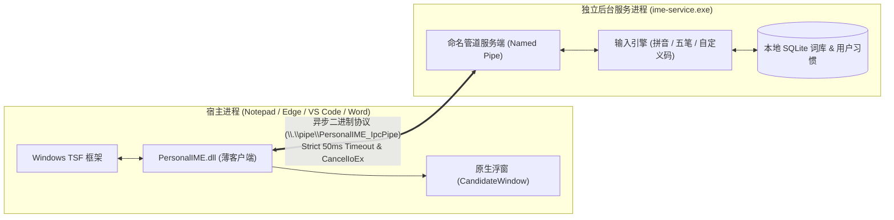

# PersonalIME (私人输入法)

[](https://microsoft.com/windows)
[](https://en.cppreference.com/w/cpp/20)
[-success.svg)]()
[](LICENSE)

**PersonalIME** 是一款面向个人用户、注重隐私控制与高性能体验的 Windows 11 中文输入法。项目采用现代 Windows Text Services Framework (TSF) 架构，支持拼音、五笔以及完全自定义的编码词条，并通过本地自适应排序引擎记录用户的输入习惯，实现“越用越顺手、数据全在本地”。

---

## 架构设计

PersonalIME 采用经典的 **“超薄宿主插件 + 独立后台服务”** 跨进程解耦架构，彻底隔离宿主进程与重型词库引擎：



### 1. 超薄进程内 TSF 客户端 (`PersonalIME.dll`)
- **注入最小化**：仅加载进入宿主进程处理基础按键分发（`ITfKeyEventSink`）与文本修改（`ITfEditSession`）。
- **零外部动态依赖**：严格使用 MSVC `/MT` 静态链接 CRT，仅依赖系统级 Windows API（`kernel32.dll`、`user32.dll`、`gdi32.dll`、`advapi32.dll`、`ole32.dll`），杜绝因缺少 VC++ Runtime 导致的加载崩溃。
- **内存与引用生命周期安全**：实现完善的 COM 引用计数配对机制与 RAII 管理，防止组件释放后引起的宿主进程崩溃。

### 2. 独立后台引擎服务 (`ime-service.exe`)
- 负责重型分词检索、拼音/五笔编码匹配、候选词生成、词频统计与 SQLite 本地持久化。
- 崩溃与重启不波及宿主：即便后台服务意外重启或升级，宿主内的输入法插件也能依靠平滑降级机制安全回退，不会引发目标应用崩溃。

### 3. 可靠跨进程通信 (IPC)
- 基于 Windows 高性能命名管道（Named Pipe）实现。
- **严格时延预算**：每次按键查询严格限制在 50ms 预算内，超时即刻调用 `CancelIoEx` 取消在途 I/O，绝不阻塞目标输入框。
- **故障自愈与状态回滚**：当发生取消或网络阻滞时，向服务端发送 `Rollback` 保持宿主组合与引擎状态严格同步，坚决避免吞键或字符错乱。

---

## 关键技术特性与稳定性保障

- **组合生命周期完整性**：
  - 严格支持 `StartComposition` 与 `EndComposition` 引用平衡与异常中断保护。
  - 支持多 Context / 多线程独立隔离，当用户失焦或切换输入框时，在途组合安全终结（`TerminateCompositionOnHost`）。
  - 针对宿主只读锁或无法即时终结的场景，引入未决终止（Pending Termination）跟踪与重试机制，防止新按键覆盖未结组合。
- **候选窗幂等性与轻量渲染**：
  - 原生 Win32 分层窗口（Layered Window）实现，单线程单例托管。
  - 窗口类注册/反注册具备引用计数保护，多次调用 `Destroy()` 具备绝对幂等性。
- **严格测试覆盖与故障注入验证**：
  - [1/5] COM DLL 引用计数与卸载安全测试（验证 TIP 活跃时阻止卸载、完全释放后恢复卸载）。
  - [2/5] 候选窗口类生命周期与多次销毁幂等性测试。
  - [3/5] 组合生命周期、多 Context 隔离、失败注入与恢复回路测试（覆盖 13 项细分用例）。
  - [4/5] 边界负向与故障注入测试（全零响应包拦截、格式畸形帧校验、管道阻塞保护、超时守护防护）。
  - [5/5] 多上下文/多线程端到端 IPC 正向集成测试。

---

## 项目结构

```text
PersonalIME/
├── CMakeLists.txt              # CMake 顶层构建配置 (C++20, /MT 静态编译)
├── README.md                   # 项目说明文档
├── docs/                       # 设计与技术文档
│   └── design.md               # 产品架构与功能设计方案
├── scripts/                    # 自动化脚本工具
│   ├── build.ps1               # 编译 Release x64 二进制文件
│   ├── run_test.ps1            # 执行五阶段端到端与故障测试套件
│   ├── register.ps1            # 注册输入法到系统 TSF (需管理员权限)
│   ├── unregister.ps1          # 从系统注销输入法
│   └── verify_hashes.ps1       # 生成所有关键二进制与源码文件的 SHA256 清单
├── src/
│   ├── common/                 # 跨模块公共头文件 (IPC 协议、GUID 定义)
│   ├── service/                # 独立后台引擎服务源码 (ime-service)
│   └── tsf_client/             # TSF 输入法客户端插件源码 (PersonalIME.dll)
└── tests/                      # 自动化测试与 Mock 宿主验证套件
```

---

## 构建与运行

### 环境要求
- **操作系统**：Windows 11 (x64)
- **编译工具**：Visual Studio 2022+（安装了“使用 C++ 的桌面开发”工作负载）
- **构建系统**：CMake 3.20+
- **SDK**：Windows 11 SDK (10.0.22000.0 或更高版本)

### 1. 编译项目
在 PowerShell 中运行构建脚本：
```powershell
powershell -NoProfile -ExecutionPolicy Bypass -File scripts\build.ps1
```
编译产物将输出至 `build\Release\` 目录：
- `PersonalIME.dll` (TSF 客户端输入法 DLL)
- `ime-service.exe` (本地后台服务)
- 测试套件可执行文件 (`test_composition_lifecycle.exe` 等)

### 2. 执行自动化测试套件
运行 5 阶段端到端及故障注入验证：
```powershell
powershell -NoProfile -ExecutionPolicy Bypass -File scripts\run_test.ps1
```

### 3. 安装与体验 (本地调试)
1. 启动本地后台服务：
   ```powershell
   .\build\Release\ime-service.exe
   ```
2. 以管理员权限运行注册脚本，将 `PersonalIME.dll` 注册至系统 TSF 输入法列表：
   ```powershell
   powershell -NoProfile -ExecutionPolicy Bypass -File scripts\register.ps1
   ```
3. 在任意文本编辑框（记事本、Edge、VS Code 等）中按下 `Win + 空格` 即可切换到 **Personal IME (私人输入法)**。
4. 调试结束后注销输入法：
   ```powershell
   powershell -NoProfile -ExecutionPolicy Bypass -File scripts\unregister.ps1
   ```

---

## 阶段规划 (Roadmap)

- [x] **Stage 1: TSF + IPC 极小原型 Spike**
  - [x] 实现最小可工作的 TSF `ITfTextInputProcessor` 框架。
  - [x] 完成命名管道跨进程通信，实现 50ms 严格超时与异步取消。
  - [x] 实现轻量级候选浮窗与按键上屏。
  - [x] 完成 8 轮严格复核，闭环 COM 引用配对、多 Context 隔离与恢复保护。
- [ ] **Stage 2: 核心输入引擎与基础词库 (进行中)**
  - [ ] 拼音全拼/双拼切词算法集成。
  - [ ] 五笔（86版/98版）编码匹配引擎。
  - [ ] 本地 SQLite 词库存储与单字/词条高效检索。
- [ ] **Stage 3: 个人词库管理与自适应排序**
  - [ ] 自定义词条新增、编辑、置顶与删除。
  - [ ] 基于频率和上下文习惯的动态自适应候选排序。
  - [ ] 词库 JSON 格式的导入、导出与本地备份。
- [ ] **Stage 4: 桌面宿主兼容性打磨与设置界面**
  - [ ] 复杂场景（浏览器沙盒环境、Office 协同编辑、终端环境）兼容性优化。
  - [ ] 独立的配置与词库管理器前端页面。

---

## 开源协议

本项目采用 [MIT License](LICENSE) 开源协议。
