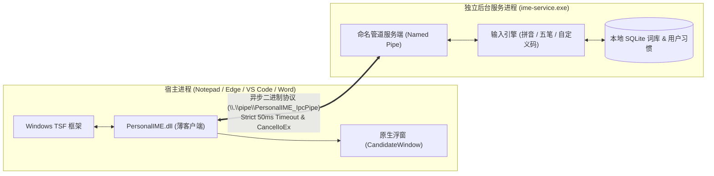

# PersonalIME (私人输入法)

[](https://microsoft.com/windows)
[](https://en.cppreference.com/w/cpp/20)
[-success.svg)]()
[](LICENSE)

**PersonalIME** 是一款面向个人用户、注重隐私控制与高性能体验的 Windows 11 中文输入法。项目采用现代 Windows Text Services Framework (TSF) 架构，支持拼音、五笔以及完全自定义的编码词条，并通过本地自适应排序引擎记录用户的输入习惯，实现“越用越顺手、数据全在本地”。

当前进度：Stage 2 核心引擎和 CLI 已完成，核心回归包含 14 组测试。TSF 后台服务仍是 Stage 1 原型，真实词典与个人排序尚待 Stage 3 接入；WPF 管理器、实际按键的模式切换与全角半角控制在后续实现。当前核心仅验证了 Windows x64，与 TSF/UI 解耦不代表已经支持其他平台。

---

## 架构设计

PersonalIME 采用经典的 **“超薄宿主插件 + 独立后台服务”** 跨进程解耦架构，彻底隔离宿主进程与重型词库引擎：



### 1. 超薄进程内 TSF 客户端 (`PersonalIME.dll`)
- **注入最小化**：仅加载进入宿主进程处理基础按键分发（`ITfKeyEventSink`）与文本修改（`ITfEditSession`）。
- **零外部动态依赖**：严格使用 MSVC `/MT` 静态链接 CRT，仅依赖系统级 Windows API（`kernel32.dll`、`user32.dll`、`gdi32.dll`、`advapi32.dll`、`ole32.dll`），杜绝因缺少 VC++ Runtime 导致的加载崩溃。
- **内存与引用生命周期安全**：实现完善的 COM 引用计数配对机制与 RAII 管理，防止组件释放后引起的宿主进程崩溃。

### 2. 独立核心引擎 (`ime-core`) 与本地存储 (`personal_ime.db`)
- **纯解耦 C++20 核心库**：`ime-core` 与 Windows TSF 框架和任何 UI 渲染完全解耦，既可作为静态库供后台输入法服务调用，也可由独立命令行工具 `ime-cli` 离线调试。
- **三类输入能力全支持**：
  - **86 五笔**：精确全码查询与前缀补全候选，严格区分全码匹配与前缀延伸。
  - **全拼音**：支持 400+ 汉语拼音声母韵母回溯切词、词库已有字词连续匹配，以及显式音节分隔符（如 `xi'an` vs `xian`，`fang'an` vs `fangan`）。
  - **自定义编码与快捷短语**：支持类似 `;dz` → `我的地址` 快捷短语，以及用户为任意词条自定义五笔或拼音编码。
- **确定性、可解释的 4 级排序机制**：
  1. *Level 1 固定置顶*：严格按用户指定顺序（`order_rank`）置顶，绝不被自动词频覆盖。
  2. *Level 2 匹配质量*：分组排序（`ExactFull` > `PrefixFull` > `PrefixCompletion`）。
  3. *Level 3 综合得分*：基础词典权重 + 个人频率加分（以 30 天为半衰期衰减累计有效频次）+ 近期使用时间加分。
  4. *Level 4 稳定平局破除*：词条稳定 ID 升序排列。
- **原子性提交学习与幂等防护**：
  - 学习只在明确提交成功（Commit）后发生；查询、浏览与取消操作绝不增加词频。
  - 支持唯一提交事件 ID（`event_id`），防止同一次提交重试被重复学习。
- **真实基础词典与用户数据 JSON 导入导出**：
  - 内置基于 Rime 开源社区整理的 86五笔（136,916 词条）和简体拼音（65,125 词条）高质量基础词典。
  - 用户数据采用 UTF-8 JSON v1.0 备份，支持 `merge`（合并）与 `replace`（覆盖）双模式，校验失败时事务级回滚。

### 3. 可靠跨进程通信 (IPC)
- 基于 Windows 高性能命名管道（Named Pipe）实现。
- **严格时延预算**：每次按键查询严格限制在 50ms 预算内，超时即刻调用 `CancelIoEx` 取消在途 I/O，绝不阻塞目标输入框。
- **故障自愈与状态回滚**：当发生取消或网络阻滞时，向服务端发送 `Rollback` 保持宿主组合与引擎状态严格同步，坚决避免吞键或字符错乱。

---

## 关键技术特性与稳定性保障

- **组合生命周期完整性**：
  - 严格支持 `StartComposition` 与 `EndComposition` 引用平衡与异常中断保护。
  - 支持多 Context / 多线程独立隔离，当用户失焦或切换输入框时，在途组合安全终结（`TerminateCompositionOnHost`）。
  - 针对宿主只读锁或无法即时终结的场景，引入未决终止（Pending Termination）跟踪与重试机制，防止新按键覆盖未结组合。
- **候选窗幂等性与轻量渲染**：
  - 原生 Win32 分层窗口（Layered Window）实现，单线程单例托管。
  - 窗口类注册/反注册具备引用计数保护，多次调用 `Destroy()` 具备绝对幂等性。
- **严格测试覆盖与故障注入验证**：
  - [1/5] COM DLL 引用计数与卸载安全测试（验证 TIP 活跃时阻止卸载、完全释放后恢复卸载）。
  - [2/5] 候选窗口类生命周期与多次销毁幂等性测试。
  - [3/5] 组合生命周期、多 Context 隔离、失败注入与恢复回路测试（覆盖 13 项细分用例）。
  - [4/5] 边界负向与故障注入测试（全零响应包拦截、格式畸形帧校验、管道阻塞保护、超时守护防护）。
  - [5/5] 多上下文/多线程端到端 IPC 正向集成测试。

---

## 项目结构

```text
PersonalIME/
├── CMakeLists.txt              # CMake 顶层构建配置 (C++20, /MT 静态编译)
├── README.md                   # 项目说明文档
├── docs/                       # 设计与技术文档
│   ├── design.md               # 产品架构与功能设计方案
│   └── dictionary-info.md      # 基础词库来源、许可与转换步骤文档
├── data/
│   └── dictionaries/           # 预编译高速基础词典 (wubi86.dict, pinyin.dict)
├── scripts/                    # 自动化脚本工具
│   ├── build.ps1               # 编译 Release x64 二进制文件
│   ├── run_test.ps1            # 执行 Stage 1 自动化测试套件
│   ├── build_dictionaries.py   # Rime 开源词典清洗与二进制格式生成脚本
│   ├── register.ps1            # 注册输入法到系统 TSF (需管理员权限)
│   ├── unregister.ps1          # 从系统注销输入法
│   └── verify_hashes.ps1       # 生成所有关键二进制与源码文件的 SHA256 清单
├── src/
│   ├── cli/                    # 独立命令行调试工具与 REPL (ime-cli)
│   ├── common/                 # 跨模块公共头文件 (IPC 协议、GUID 定义)
│   ├── core/                   # 独立输入核心引擎 (ime-core)
│   │   ├── dictionary/         # 高速内存词典索引 (Multi-Map & 二分检索)
│   │   ├── encoding/           # 拼音音节切分、五笔与自定义编码解析
│   │   ├── engine/             # 统一门面 facade (ImeEngine)
│   │   ├── ranking/            # 确定性 4 级排序机制与得分解释器
│   │   └── storage/            # SQLite 数据库包装、版本迁移与 JSON 备份
│   ├── service/                # 独立后台引擎服务源码 (ime-service)
│   ├── third_party/            # 第三方轻量库 (SQLite3, nlohmann/json)
│   └── tsf_client/             # TSF 输入法客户端插件源码 (PersonalIME.dll)
└── tests/                      # 自动化测试与 Mock 宿主验证套件
    └── test_ime_core.cpp       # Stage 2 核心引擎 10 大场景严密测试集
```

---

## 命令行调试工具 (`ime-cli`)

Stage 2 提供了功能完备的交互式命令行调试器，用于完全独立于系统 TSF 环境验证分词、编码匹配、排序权重、习惯学习及词库导入导出。

### 启动方式
```powershell
# 启动交互式 REPL 终端
.\build\Release\ime-cli.exe

# 或直接通过命令行参数执行单次操作 (支持 --db 与 --dict 指定路径)
.\build\Release\ime-cli.exe <command> [args...]
```

### 命令语法与示例

| 命令类别 | 语法 | 示例 | 说明 |
| :--- | :--- | :--- | :--- |
| **拼音查询** | `query \| q pinyin <code>` | `.\build\Release\ime-cli.exe query pinyin zhongwen` | 查询候选词，区分完全匹配与前缀补全 |
| **音节分隔** | `q pinyin <code>` | `.\build\Release\ime-cli.exe query pinyin "xi'an"` | 显式音节切分，精确消除歧义 |
| **五笔查询** | `q wubi <code>` | `.\build\Release\ime-cli.exe query wubi aaaa` | 支持 86 五笔单字、词组全码与前缀检索 |
| **快捷短语** | `q custom <code>` | `.\build\Release\ime-cli.exe query custom ";dz"` | 查询自定义编码与短语 |
| **得分解释** | `explain <scheme> <code>` | `.\build\Release\ime-cli.exe explain pinyin zhongwen` | 打印各候选词的置顶状态、质量等级、频次得分与总分 |
| **新增词条** | `add <text> <scheme:code>...` | `.\build\Release\ime-cli.exe add 我的地址 "custom:;dz" pinyin:wodedizhi` | 支持单个词条同时绑定多个输入方案与编码 |
| **词条修改** | `edit <id> <new_text>` | `.\build\Release\ime-cli.exe edit u_6ae85... "北京市海淀区中关村"` | 修改自定义词条正文 |
| **删除词条** | `del <id>` | `.\build\Release\ime-cli.exe del u_6ae85...` | 删除指定词条及其全部编码绑定与统计 |
| **置顶候选** | `pin <scheme> <code> <id> [rank]` | `.\build\Release\ime-cli.exe pin custom ";dz" u_6ae85... 1` | 固定候选词在特定编码下的展示顺序（不影响其他编码） |
| **取消置顶** | `unpin <scheme> <code> <id>` | `.\build\Release\ime-cli.exe unpin custom ";dz" u_6ae85...` | 解除置顶，回归自适应动态排序 |
| **模拟提交** | `commit <scheme> <code> <id> [evt_id]` | `.\build\Release\ime-cli.exe commit pinyin zhongwen b_py_1` | 模拟按键上屏成功，触发学习（支持幂等 event_id） |
| **重置统计** | `reset-stats [id]` | `.\build\Release\ime-cli.exe reset-stats` | 重置指定词条或全库的学习频次与时间戳 |
| **导出词库** | `export <file.json>` | `.\build\Release\ime-cli.exe export my_backup.json` | 导出 UTF-8 JSON v1.0 格式用户数据 |
| **导入词库** | `import <file.json> [merge\|replace]` | `.\build\Release\ime-cli.exe import my_backup.json merge` | 导入数据，支持合并或覆盖模式，错误全事务回滚 |
| **性能基准** | `bench` | `.\build\Release\ime-cli.exe bench` | 评测 1,000 次高频检索延迟与词库加载性能 |

### 性能基准指标 (Benchmark)
- **内存词典容量**：内置 202,041 条真实开源基础词库（86五笔 136,916 词条 + 简体拼音 65,125 词条）。
- **加载启动耗时**：全库加载并构建内存索引耗时 **< 150 ms**。
- **单次检索延迟**：平均查询响应时延 **< 250 微秒 (0.25 ms)**，远低于 50ms IPC 预算。

---

## 构建与运行

### 环境要求
- **操作系统**：Windows 11 (x64)
- **编译工具**：Visual Studio 2022+（安装了“使用 C++ 的桌面开发”工作负载）
- **构建系统**：CMake 3.20+
- **SDK**：Windows 11 SDK (10.0.22000.0 或更高版本)

### 1. 编译项目
在 PowerShell 中运行构建脚本：
```powershell
powershell -NoProfile -ExecutionPolicy Bypass -File scripts\build.ps1
```
编译产物将输出至 `build\Release\` 目录：
- `PersonalIME.dll` (TSF 客户端输入法 DLL)
- `ime-service.exe` (本地后台服务)
- `ime-cli.exe` (输入法核心引擎命令行调试器)
- `test_ime_core.exe` (Stage 2 核心引擎自动化测试集)
- `test_composition_lifecycle.exe` 等 (Stage 1 稳定性测试集)

### 2. 执行自动化测试套件
```powershell
# 运行 Stage 1 TSF + IPC 稳定性回归套件
powershell -NoProfile -ExecutionPolicy Bypass -File scripts\run_test.ps1

# 运行 Stage 2 核心输入引擎、排序算法与存储持久化套件
.\build\Release\test_ime_core.exe
```

### 3. 安装与体验 (本地调试)
1. 启动本地后台服务：
   ```powershell
   .\build\Release\ime-service.exe
   ```
2. 以管理员权限运行注册脚本，将 `PersonalIME.dll` 注册至系统 TSF 输入法列表：
   ```powershell
   powershell -NoProfile -ExecutionPolicy Bypass -File scripts\register.ps1
   ```
3. 在任意文本编辑框（记事本、Edge、VS Code 等）中按下 `Win + 空格` 即可切换到 **Personal IME (私人输入法)**。
4. 调试结束后注销输入法：
   ```powershell
   powershell -NoProfile -ExecutionPolicy Bypass -File scripts\unregister.ps1
   ```

---

## 阶段规划 (Roadmap)

- [x] **Stage 1: TSF + IPC 极小原型 Spike**
  - [x] 实现最小可工作的 TSF `ITfTextInputProcessor` 框架。
  - [x] 完成命名管道跨进程通信，实现 50ms 严格超时与异步取消。
  - [x] 实现轻量级候选浮窗与按键上屏。
  - [x] 完成 8 轮严格复核，闭环 COM 引用配对、多 Context 隔离与恢复保护。
- [x] **Stage 2: 独立核心输入引擎与命令行调试器 (已完成)**
  - [x] 86 五笔编码匹配引擎（精确匹配与前缀补全）。
  - [x] 全拼切词引擎（400+ 音节集回溯切词、显式音节分隔符 `'` 消除歧义）。
  - [x] 自定义编码与快捷短语（类似 `;dz` → `我的地址`，多方案自由绑定）。
  - [x] SQLite 持久化存储（版本化迁移、事务隔离、WAL 模式、线程安全）。
  - [x] 确定性、可解释的 4 级候选排序机制（置顶、匹配质量、30天半衰期频次衰减、近期加分、稳定 ID 破平局）。
  - [x] 严谨的学习与提交防护（仅在 Commit 发生、幂等 event_id 防重试干扰）。
  - [x] 真实大规模词典（202,041 条目，Rime 开源协议合规）。
  - [x] 用户词库 UTF-8 JSON v1.0 导入/导出与事务回滚保障。
  - [x] 交互式 REPL 命令行调试工具 `ime-cli` 与 10 大场景自动化测试套件。
- [ ] **Stage 3: 引擎接入后台服务与端到端输入打通**
  - [ ] 将 `ime-core` 与 `ime-service` 命名管道协议对接。
  - [ ] 键盘事件与候选词翻页、数字选词映射。
  - [ ] 宿主候选窗多行/单行展示与高分词即时上屏。
- [ ] **Stage 4: 桌面宿主兼容性打磨与设置界面**
  - [ ] 复杂场景（Chrome/Edge 沙盒环境、VS Code 协同编辑、终端环境）兼容性优化。
  - [ ] 独立的配置与词库管理器前端页面。
  - [ ] 独立的配置与词库管理器前端页面。

---

## 开源协议

本项目采用 [MIT License](LICENSE) 开源协议。
