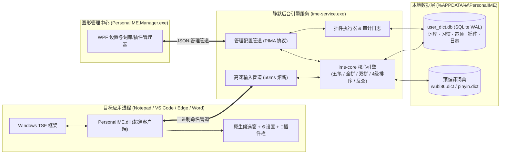

# 人人 (RenRen IME)

[](https://microsoft.com/windows)
[](https://apple.com/macos)
[](https://en.cppreference.com/w/cpp/20)
[](https://dotnet.microsoft.com/)
[](https://sqlite.org/)
[](LICENSE)

> **人人输入法 —— 让每个人都能拥有属于自己的输入法，做那个越来越懂你的输入伙伴。**
>
> *智能五笔 · 拼音混输 · 零打扰 · 数据全在本地的现代 Windows 中文输入法*

## 💡 产品立意：为什么叫“人人”？

千人一面的商业输入法试图用云端大词库替所有人做决定，却往往打乱了个人的肌肉记忆、塞满了弹窗与噪音。
**人人** 的初心很简单：**输入法不该是千篇一律的公共工具，而应是每个人亲手驯化、私密专享的数字器官。**

- **人人皆可定制**：词库、编码、排序位次、候选框插件全部向你敞开，你的每一个用词偏好都由你全权定义。
- **越来越懂你**：每一次选词上屏、每一个置顶固定、每一条随手添加的短语，都会沉淀在专属于你的本地数据库里，伴随你的创作与工作自然生长，真正成为一个**越用越顺手、越来越懂你的输入法**。

---

## ✨ 核心产品价值

### 1. 🔒 100% 本地隐私与数据主权
- **零云端上传**：不收集任何击键记录，无后台联网遥测，无广告推送。
- **单文件透明存储**：所有自定义词条、个人词频习惯、置顶排序及插件配置统一存储于本地 `%APPDATA%\PersonalIME\user_dict.db`（SQLite WAL 模式）。
- **一键迁移备份**：支持标准 UTF-8 JSON 格式全量导入/导出（合并或覆盖模式），换机无缝衔接。

### 2. 🎯 多源瀑布流混输与智能反查补全
- **多方案自由组合**：内置 86 五笔（13.6 万词条）、全拼（6.5 万词条）与主流双拼方案（自然码、微软双拼、小鹤双拼，复用拼音词库零冗余）。
- **多源瀑布流召回算法 (Multi-Source Waterfall Recall)**：
  - **自定义叠加层 (Non-Blocking Custom Overlay)**：用户自定义词库作为特权置顶层优先展示，但绝不截断后续内置主词库。
  - **动态阈值次级补全 (`fallback_candidate_threshold`)**：当主输入方式（如五笔）的精确匹配候选词少于设定阈值（默认 `< 3` 个，支持 `0~9` 自由调节）时，引擎自动穿透召回次级输入方式（如全拼/双拼）词库中的精确匹配词条，排在主方案精确词之后、前缀补全词之前。
  - **反向编码内联标注 (Reverse-Lookup Code Annotation)**：凡由次级输入方式自动补全的候选词，自动反查并内联标注其主输入方式的拆字编码（例如五笔模式下输入 `ni`，候选框展示 `1. 展`、`2. 你 [wq]`、`3. 泥 [imn]`），点击或按数字键上屏时仅输出纯净正文，真正做到“提笔忘字不卡壳，边打字边记码”。

### 3. 📌 确定性排序与肌肉记忆保护
- **拒绝“词频乱跳”**：独创可解释的多级确定性排序机制：
  1. **用户固定置顶 (Pinned)**：指定编码下的置顶词条拥有绝对最高优先级，支持可视化的上下调序，绝不被自动调频打乱肌肉记忆。
  2. **编码匹配质量**：精确全码匹配 (`ExactFull`) > 前缀补全延伸 (`PrefixCompletion`)。
  3. **输入方案与词典层级**：主输入方式优先于次级补全方案；同方案内用户自定义词库优先于系统内置词库。
  4. **自适应习惯权重**：基于 30 天半衰期时间衰减算法，平滑融合个人高频习惯与近期使用加分。
  5. **稳定平局兜底**：同分候选词严格保持稳定顺序。
- **丰富词条形态**：支持单字、词组、快捷短语（如 `;dz` → 收货地址、`mail` → 邮箱）、Emoji 表情符号以及多行代码/文本模板一键上屏。

### 4. 🧩 候选栏内嵌轻量级扩展插件
- **即点即用，不抢焦点**：候选框右侧内嵌快捷设置按钮 `⚙` 与自定义插件图标栏（采用 `MA_NOACTIVATE` 原生浮窗技术，点击绝不破坏当前编辑器的输入焦点与光标）。
- **开箱预置与自由扩展**：
  - 默认预置：**计算器 (`🧮`)**、**画图 (`🎨`)**、**Edge 浏览器 (`🌐`)**。
  - 灵活扩展：通过 SQLite 插件配置，可将 **截图 (`ms-screenclip:`)**、**天气查询**、**星座运势**、**本地脚本/开发工具** 直接挂载到候选栏。
- **执行审计日志**：内置插件执行日志记录与状态追踪，每次唤起的时间、参数与成功/异常状态一目了然。

### 5. ⚡ 工业级宿主隔离与亚毫秒响应
- **宿主零崩溃承诺**：注入目标应用（记事本、VS Code、Office、浏览器）的 `PersonalIME.dll` 采用纯 `/MT` 静态编译，零第三方动态库依赖。
- **极速检索与超时熔断**：核心词库内存检索耗时 **< 0.25 毫秒**；跨进程 IPC 严格设定 50ms 熔断保护，哪怕后台服务重启，输入框也绝不假死。
- **静默一体化体验**：用户感知不到复杂的“客户端/服务端”概念——切出输入法自动就绪，任务栏托盘与候选框 `⚙` 按钮一键唤起设置中心。

---

## 🖥️ 产品功能全景

### 1. 现代原生候选浮窗
- 清晰展示当前输入编码、编号候选词（激活项蓝色圆角高亮徽标）、次选编码提示。
- **全能键盘与鼠标选词交互**：支持 `←`/`→`/`↑`/`↓` 方向键切换选中候选词（跨边界自动翻页），支持鼠标悬停（Hover）实时切换选中项，支持鼠标左键点击、`Space` 或 `Enter` 直接上屏当前高亮候选词，以及鼠标滚轮上下翻页。
- 尾部集成 **`⚙` 设置入口** 与 **动态插件图标栏**，统一视觉分隔线、圆角高光与手型光标交互。

### 2. 图形化设置与管理中心 (`设置`)
提供五大核心管理模块：
1. **词库管理**：按关键字与输入方案实时筛选词条，**支持同时联查用户个性词库与系统内置基础词库（如“歧义”）**，带【系统内置】与【用户词库】清晰来源标识，支持系统词一键带入编辑与自定义。
2. **词条排序**：查询任意编码下的全部候选词（含系统内置词库与用户词库），一键置顶/取消置顶、可视化调整固定位次。
3. **输入设置**：调整每页候选词数量（5~9）、主输入方案、双拼键位方案、混输开关、动态调频开关、中英/全半角初始状态。
4. **插件管理**：可视化管理候选栏扩展插件（图标、名称、执行路径、启动参数、启用状态、排序），支持一键测试运行与查看/清空执行日志。
5. **系统与诊断**：实时监控引擎连接状态、词库容量统计、JSON 数据导入导出、学习词频一键重置。

### 3. ⌨️ 常用快捷键与操作
| 快捷键 | 功能说明 |
| :--- | :--- |
| **`CapsLock`** 或 **`Ctrl + Space`** | **中 / 英文模式切换**。<br>• 切换至英文模式后，键盘直接输入**默认输出英文小写**（如 `abc`）；<br>• 需要大写时按住 **`Shift + 字母`** 辅助输出大写（如 `A`）；<br>• `Ctrl+C`、`Ctrl+V` 等常用系统快捷键原生透传放行。 |
| **`Space`** 或 **`Enter`** | 确认上屏当前高亮选中的候选词。 |
| **`1` ~ `9`** | 数字键直选对应序号的候选词上屏。 |
| **`←` / `→` / `↑` / `↓`** | 方向键高亮选中项移动（跨越首末项时自动触发上/下翻页）。 |
| **`-` / `=`** 或 **`PageUp` / `PageDown`** | 候选词列表上一页 / 下一页翻页。 |

---

## 🚀 快速开始

### 方式一：Windows 用户安装体验
1. **安装包安装（推荐）**：
   下载并运行 `PersonalIME-Setup-x64.exe`，向导将自动完成组件部署、TSF 输入法注册与开机静默自启配置。
2. **绿色便携版免安装体验**：
   下载并解压 `PersonalIME-v*-portable-x64.zip` 到任意目录（如 `D:\PersonalIME`）：
   - 双击运行 **`start.bat`**：一键注册 TSF 输入法、静默启动后台服务并拉起设置中心。
   - 双击运行 **`stop.bat`**：一键反注册并安全停止后台服务，实现无残留彻底卸载。
3. **开始打字**：
   打开任意文本框或编辑器（如记事本），按 `Win + 空格` 切换至 **人人** 即可开始输入；点击候选框右侧 `⚙` 或任务栏托盘图标可随时打开设置中心。

### 方式二：macOS 用户安装体验
1. **PKG 安装包（推荐）**：
   下载并双击运行 `PersonalIME-macOS-v1.1.0.pkg`，按向导一键安装至系统 `/Library/Input Methods/` 目录。
2. **DMG 镜像安装**：
   下载并挂载 `PersonalIME-macOS-v1.1.0.dmg`，将 `PersonalIME.app` 复制至 `/Library/Input Methods/` 目录。
3. **本地一键安装脚本（源码构建）**：
   在终端执行 `sudo ./scripts/install_mac.sh`，脚本将自动完成安装、代码重签名、系统注册与服务拉起。
4. **启用并开始输入**：
   - 打开 macOS「系统设置」->「键盘」->「文字输入」->「编辑...」；
   - 点击左下角「+」，在「简体中文」中选中「人人输入法 (PersonalIME)」并添加；
   - **关键操作**：点击右下角蓝色的「完成 (Done)」按钮保存设置；
   - 按 `Control + Space` 切换输入法即可畅享输入；点击候选栏右侧 `⚙` 可打开原生设置中心。
   - *(注：若系统提示“无法打开，因为无法验证开发者”，在「系统设置」->「隐私与安全性」最下方点击“仍要打开”即可)*。

### 方式三：开发者本地极速迭代 (`dev.ps1` / `install_mac.sh`)
为方便日常开发与人工测试，项目提供了独立于 CI 的秒级开发脚本 `scripts/dev.ps1`：

```powershell
# 一键完成：释放进程锁 -> 增量编译 -> 注册并自动切换系统默认输入法为“人人” -> 静默启动服务 -> 打开记事本测试
powershell -ExecutionPolicy Bypass -File scripts\dev.ps1

# 常用开发命令：
powershell -ExecutionPolicy Bypass -File scripts\dev.ps1 -Action status   # 查看当前注册状态、服务进程与 DLL 加载宿主
powershell -ExecutionPolicy Bypass -File scripts\dev.ps1 -Action manager  # 直接打开“人人 设置”图形管理界面
powershell -ExecutionPolicy Bypass -File scripts\dev.ps1 -Action reload   # 不重新编译，快速重启后台服务与记事本
powershell -ExecutionPolicy Bypass -File scripts\dev.ps1 -Action stop     # 停止测试环境
```

> **提示**：首次在系统注册 TSF 输入法或刷新 `Win + 空格` 系统级名称缓存时，请以管理员身份执行一次：
> ```powershell
> powershell -ExecutionPolicy Bypass -File scripts\register.ps1
> ```

---

## 🏗️ 系统架构概览



---

## 📦 完整构建、测试与打包发布

### 环境要求
- **操作系统**：Windows 10 / 11 (x64)
- **编译环境**：Visual Studio 2022+（C++ 桌面开发工作负载）、CMake 3.20+、.NET 10.0 SDK

### 全流程命令
```powershell
# 1. 编译全部 C++ 核心、服务、TSF 客户端与 12 组原生测试套件
powershell -ExecutionPolicy Bypass -File scripts\dev.ps1 -Action build -BuildTests

# 2. 运行 C++ 管理管道与插件集成测试
.\build\Release\test_admin_ipc.exe

# 3. 运行 C++ 候选窗与插件交互测试
.\build\Release\test_candidate_window.exe

# 4. 运行 WPF 管理器 .NET 单元测试 (50 项用例)
dotnet test src\manager\PersonalIME.Manager.Tests

# 5. 一键生成发布包 (Portable ZIP + SHA256 清单 + Inno Setup 安装包)
powershell -ExecutionPolicy Bypass -File scripts\package_release.ps1
```

---

## 🗺️ 产品演进路线图 (Roadmap)

### 已交付里程碑 (Stage 1 ~ Stage 5)
- [x] **Stage 1：TSF 宿主安全与跨进程通信基座**（COM 引用安全、多 Context 隔离、50ms 超时保护、原生候选浮窗）
- [x] **Stage 2：多方案核心引擎与本地持久化**（86 五笔、全拼、自定义短语、4 级确定性排序、SQLite WAL、20万+ 词典、`ime-cli`）
- [x] **Stage 3：端到端输入闭环与回执可靠性**（中英/全半角/标点转换、WAL 持久化回执日志、无感进程守护）
- [x] **Stage 4：现代化 WPF 管理中心与高阶特性**（词库 CRUD、内置词条置顶调序、双拼多方案支持、编码反查、系统诊断）
- [x] **Stage 5：产品化重塑“人人”与轻量插件生态**（全链路品牌升级、SVG 矢量图标、候选栏插件矩阵与日志审计、一键安装包与 `dev.ps1` 工作流）

### 下一阶段演进 (Stage 6：智能辅助与交互体验全面升级)
- [x] **1. 多源瀑布流召回与智能跨方案反查补全（少候选自动兜底 + 编码提示）**
  - 用户自定义词库作为置顶叠加层（Overlay），不阻断内置主词库候选。
  - 当主输入方案（如五笔）精确匹配结果少于阈值（默认 `< 3` 个，可在设置中配置 `0~9`）时，自动调用次级输入方案（如拼音/双拼）检索补充精确候选词。
  - 对次级方案补充的候选词，在候选框内附带显示其对应的主方案编码（例如打 `ni` 出 `1. 展`、`2. 你 [wq]`、`3. 泥 [imn]`），实现“边打字边学码”。
- [x] **2. 候选浮窗深度交互（方向键导航与鼠标直选）**
  - 支持键盘 `↑`/`↓` 或 `←`/`→` 在当前页候选词间移动高亮选中项（到页首/页尾自动触发上/下翻页），`Space`/`Enter` 直接上屏当前高亮候选词。
  - 支持鼠标悬停（Hover）候选词实时切换高亮选中项、鼠标左键单击任意候选词直接上屏、鼠标滚轮上下翻页。
- [x] **3. 长词组与短句整句输入引擎与动态宏扩展**
  - **多音节/多字根动态规划切分 (DAG + Viterbi)**：构建拼音音节图与五笔四码连打切分器，支持连续输入长词组与完整短句（如 `renrenshurufa` → `人人输入法`）。
  - **智能造词与短句记忆**：自动组合未登录长词短句，在整句上屏确认后自动沉淀并记录至用户学习词库。
  - **动态智能宏扩展**：支持日期（`rq`/`date`）、时间（`sj`/`time`）、星期（`xq`/`week`）及数字金额大写转换（`v12345` → `壹万贰仟叁佰肆拾伍`）实时动态生成候选。
- [ ] **4. 交互细节与状态感知迭代待办**
  - 单击 `Shift` 键快速切换中英文模式。
  - 任务栏托盘图标随中英文模式动态切换为微标“中”或“英”。
  - 中/英文标点切换（`Ctrl + .`）与全半角切换（`Shift + Space`）以及屏幕状态浮窗提示。
  - 输入方案快捷键循环切换（`Ctrl + Shift`）与界面联动提示。

> 详细技术设计请参阅：
> - [插件化架构演进设计 (天气/星座/截图方案对比)](docs/plugin-architecture-design.md)
> - [Stage 6 智能反查、交互选词与整句输入架构方案](docs/stage6-smart-input-design.md)

---

## 📄 开源协议

本项目基于 [MIT License](LICENSE) 开源发布。内置词典数据源自 Rime 开源社区，遵循其开源许可协议。
