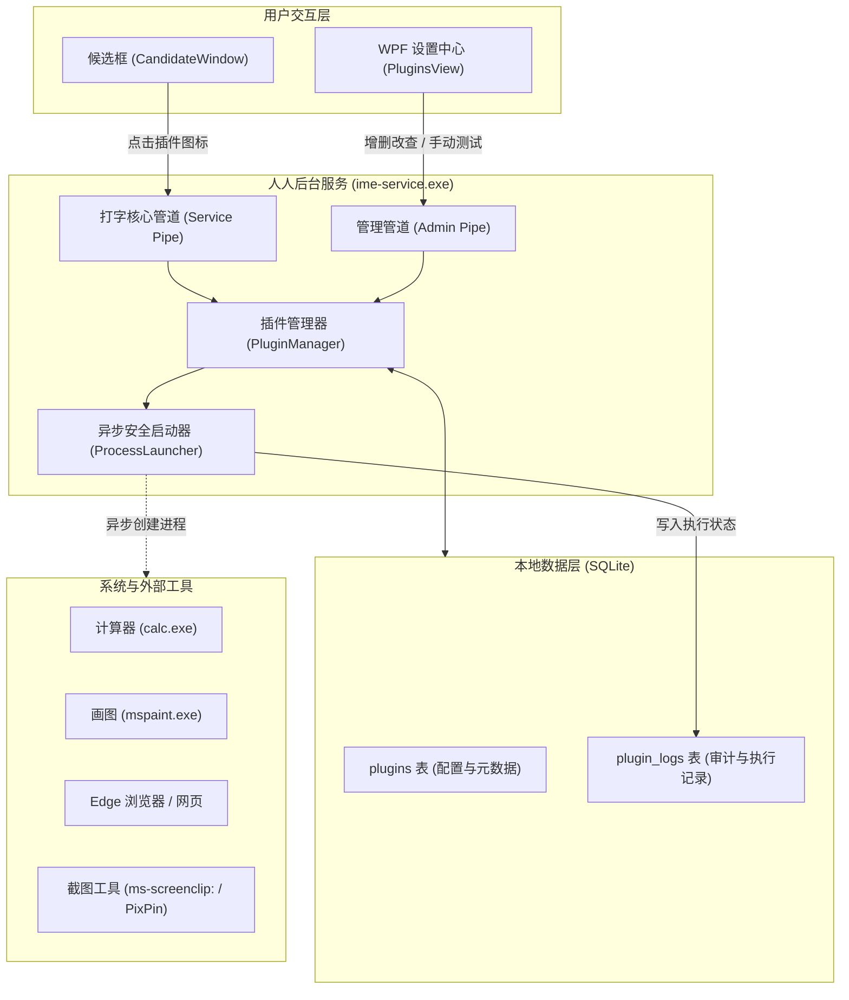

# 人人输入法：扩展插件系统架构设计文档

> **版本**：v1.0 (Stage 5 Extension)  
> **状态**：已落地实施  
> **数据存储**：本地 SQLite (`%APPDATA%\PersonalIME\user_dict.db`)  
> **交互形态**：候选浮窗极速启动栏 + WPF 独立设置中心统一管理  

---

## 1. 背景与历史方案回顾

在早期的输入法需求规划与传统输入法（如搜狗、QQ 拼音、百度输入法等）中，天气查询、星座运势、截图与 OCR 等功能往往作为“输入法衍生体验”被提出。

### 1.1 原来的方案是什么？

在原有设想及传统桌面输入法中，这类功能通常采用 **“单体内置扩展”（Monolithic In-Process / In-Daemon Extension）** 方案：

```
+-----------------------------------------------------------------+
|                        宿主或后台服务进程                        |
|                                                                 |
|   +---------------+     +-----------------------------------+   |
|   | 核心编码引擎   |     | 内置扩展模块                       |   |
|   | (五笔/拼音)    |     |                                   |   |
|   +---------------+     |   - HTTP 天气轮询客户端            |   |
|                         |   - 星座 API / 离线黄历代码包      |   |
|                         |   - 内置 D3D/GDI 屏幕抓图 Hook    |   |
|                         |   - 本地内嵌 OCR 模型 (Paddle/Tess)|   |
|                         +-----------------------------------+   |
+-----------------------------------------------------------------+
```

#### 原方案的核心痛点：
1. **侵犯“本地优先、纯净可控”承诺**：
   - 输入法核心框架引入 HTTP 请求与网络解析库，增加了联网权限，引发用户对“输入内容外泄 / 遥测”的隐私恐慌。
2. **严重的稳定性与性能隐患**：
   - 网络波动或远端天气接口响应超时，会导致后台服务线程卡顿，直接波及前端打字 `< 1ms` 吞吐。
   - 截图与 OCR 涉及重型图形捕获与多媒体内存分配，一旦发生访问越界或崩溃，会直接拖死整个输入法服务。
3. **僵化不可控，无法满足个性化定制**：
   - 截图工具被死死绑定在输入法内置的简陋截图框上，用户无法换成自己习惯的专业工具（如 Windows 11 原生截图、Snipaste、PixPin 等）。
   - 用户无法自定义想要一键打开的工作辅助工具（如计算器、专业画图、常用业务后台）。

---

## 2. 现代插件机制：外部进程解耦与统一协议架构

### 2.1 设计理念

将天气、星座、截图以及各类日常高频工具，彻底从“单体硬编码”转变为 **“基于 SQLite 的通用进程/协议插件系统”**：

- **零常驻负担**：输入法本体只负责调度，不集成任何重型第三方代码。
- **沙盒安全与跨进程隔离**：无论插件发生什么异常，输入法按键响应永远安全稳定。
- **本地化与全透明**：插件元数据与每次执行历史全量沉淀在本地 SQLite，记录执行命令与时间戳。

### 2.2 整体架构图



---

## 3. 天气、星座、截图在插件机制下的落地方案

| 原始需求 | 插件落地方式 | 预置/推荐路径 (`exec_path`) | 参数 (`arguments`) | 图标 | 相比原方案的优势 |
| :--- | :--- | :--- | :--- | :---: | :--- |
| **截图 / OCR** | **原生系统协议 / 专业工具直调** | `ms-screenclip:` 或 `snippingtool.exe` | `/clip` | `✂️` | 毫秒级唤起 Windows 11 最新原生智能截图（自带 OCR 提取文字与二维码识别），输入法进程 **0 KB 内存增加，0 行截图绘制代码**！用户亦可随时替换为 `Snipaste.exe`。 |
| **实时天气** | **极速 Web 协议或专属脚本** | `msedge.exe` 或 `explorer.exe` | `https://weather.cma.cn` 或 本地轻量天气 CLI | `🌤️` | 彻底移除输入法网络请求代码，满足纯净离线安全；点击瞬间直达气象局高精度雷达实况图。 |
| **星座运势** | **极速聚合入口 / 本地脚本** | `msedge.exe` | `https://www.xzw.com/fortune/` 或 用户自建星座 API | `♈` | 自由更换喜欢的星座源，数据不在输入法本地死锁，避免为了每年固定的黄历算法塞入冗余离线数据。 |
| **计算器** | **开发阶段预置内置工具** | `calc.exe` | *(无)* | `🧮` | 办公场景下打字时遇到计算需求，无需切桌面或按 Win 键搜索，候选栏一键唤出。 |
| **画图** | **开发阶段预置内置工具** | `mspaint.exe` | *(无)* | `🎨` | 快速草图、签名、剪贴板图像临时保存。 |
| **Edge 浏览器** | **开发阶段预置内置工具** | `msedge.exe` | `https://maifeipin.com` | `🌐` | 验证支持携带 URL 及各类启动参数的外部应用程序。 |

---

## 4. SQLite 数据表设计

存储在当前用户上下文专属的 `%APPDATA%\PersonalIME\user_dict.db` 中：

### 4.1 插件定义表 (`plugins`)
```sql
CREATE TABLE IF NOT EXISTS plugins (
    id INTEGER PRIMARY KEY AUTOINCREMENT,
    name TEXT NOT NULL,                     -- 插件展示名称 (如 "计算器", "截图")
    icon TEXT NOT NULL,                     -- 图标 (Emoji 或 文本字符, 如 "🧮", "✂️")
    exec_path TEXT NOT NULL,                -- 可执行文件路径或协议 (如 "calc.exe", "ms-screenclip:")
    arguments TEXT NOT NULL DEFAULT '',     -- 启动命令行参数 (如 "https://maifeipin.com")
    is_enabled INTEGER NOT NULL DEFAULT 1,  -- 是否在候选栏展示 (1=启用, 0=禁用)
    sort_order INTEGER NOT NULL DEFAULT 0,  -- 候选栏排列顺序
    created_at INTEGER NOT NULL DEFAULT (strftime('%s', 'now'))
);
```

### 4.2 插件执行日志表 (`plugin_logs`)
```sql
CREATE TABLE IF NOT EXISTS plugin_logs (
    id INTEGER PRIMARY KEY AUTOINCREMENT,
    plugin_id INTEGER,                     -- 关联的插件 ID
    plugin_name TEXT NOT NULL,             -- 冗余插件名称，防插件被删后日志失联
    command_line TEXT NOT NULL,            -- 实际执行的完整命令行
    executed_at INTEGER NOT NULL DEFAULT (strftime('%s', 'now')),
    status TEXT NOT NULL,                  -- 'SUCCESS' 或 'FAILED'
    message TEXT NOT NULL DEFAULT ''       -- 成功返回的进程 PID 或 Windows 错误码描述
);
```

---

## 5. 候选窗口与样式对齐规范

候选栏位于用户视线最焦点处，插件按钮必须与“设置”按钮 (`⚙`) 保持极致的视觉与交互一致性：

1. **尺寸与布局**：
   - 候选词列表之后紧随设置齿轮按钮 (`⚙`)；
   - 紧随设置按钮之后，依次横向排布已启用的插件按钮，每个插件占用标准 `28px` 宽度与完整候选条高度；
   - 每个按钮之间保留像素级淡灰竖向分割线 (`RGB(230, 233, 238)`)。
2. **交互反馈**：
   - 鼠标悬停（Hover）：与设置按钮完全一致的淡灰背景浅圆角高亮 (`RGB(242, 244, 247)`)，光标自动变手型 (`IDC_HAND`)；
   - 鼠标按下（Pressed）：柔和按压深色高亮 (`RGB(226, 234, 246)`)；
   - **焦点保护机制**：所有插件按钮在 Windows 层面统一标记为 `MA_NOACTIVATE`，点击时绝不夺取记事本/Office 宿主的原生打字光标；
   - 点击时自动结算未完成的输入编码，防止留下遗留虚线下划线。
3. **异常容错**：
   - 插件执行完全在工作线程或服务进程中异步执行，即便外部程序启动耗时（如大型冷启动应用），候选条窗口 0 延迟、0 丢帧。

