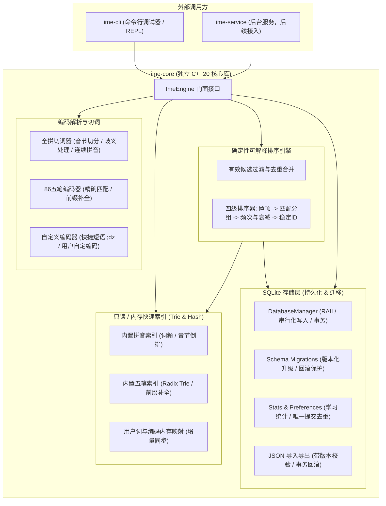

# Stage 2 输入引擎与命令行调试工具设计方案

本文档根据用户要求与 [`docs/design.md`](design.md) 制定，覆盖 **Stage 2** 的交付范围、核心架构、数据模型、排序规则、真实词典规划、CLI 设计以及全量验证方案。

---

## 一、交付范围与模块架构



### 1. 核心解耦原则
- `ime-core` 纯 C++20 库，绝对不包含 TSF 头文件、Win32 窗口渲染、或消息循环。
- 支持 Windows 11 x64、MSVC `/MT` 纯静态编译。
- 提供线程安全的读写分离：
  - 查询路径（Read Path）：毫秒级内存索引过滤与候选计算，不被磁盘写锁阻塞。
  - 学习与修改路径（Write Path）：异步或串行化后台写任务，严格采用 SQLite 事务。

---

## 二、三类输入能力设计

### 1. 86 版五笔 (`Wubi86`)
- **编码范围**：`a-z`（通常取 1~4 码）。
- **匹配分组**：
  - `ExactFull`（完整匹配）：用户输入的编码与词条五笔编码完全一致（例如输入 `aaaa` 匹配“工”或“恭恭敬敬”）。
  - `PrefixCompletion`（补全候选）：词条编码以此输入为前缀（例如输入 `aa`，前缀补全返回 `aaaa` 的“工”）。
- **单字与词组拆分规则**：基于内置 86 版五笔词典，支持 1~4 键的精确击键与简码、全码。

### 2. 全拼 (`Quanpin`)
- **音节解析（Syllable Segmentation）**：
  - 规范化声韵母切分：支持贪婪最长匹配与合规拼音音节全集（如 `zhong`, `wen`, `xian`, `an`, `fang` 等 400+ 标准音节）。
  - 音节分隔符 `'` 支持：例如 `xi'an` 解析为 `[xi, an]`（西安），而 `xian` 解析为 `[xian]`（先/线/县）优先，兼顾 `[xi, an]`。
  - 词库内字词连续匹配：首版支持多音节匹配词典内已有字词（例如输入 `zhongwen` 匹配 `中文`；输入 `beijing` 匹配 `北京`）。
- **匹配分组**：
  - `ExactFull`：音节完整覆盖输入串且匹配词条。
  - `PrefixFull`：前缀音节组合完整匹配词条（例如输入 `zhongw` 匹配 `中文` 的前缀）。
  - `PrefixCompletion`：不完整音节补全。

### 3. 自定义编码与快捷短语 (`Custom`)
- **快捷短语**：前缀引导符支持，如 `;dz` → `我的地址`，`;rq` → `2026年11月02日`。
- **自定义编码映射**：用户可为任意词语指定拼音编码（如为“得”指定额外的自定义注音）、五笔编码或独立快捷编码。
- **模式隔离**：拼音模式下不误触发五笔编码；快捷短语支持独立开关或双模式透传。

---

## 三、SQLite 数据模型与迁移机制

采用版本化迁移系统（`PRAGMA user_version`），当前 Schema Version = 1。

```sql
-- 1. 词条表 (稳定 ID、正文、来源)
CREATE TABLE IF NOT EXISTS entries (
    id TEXT PRIMARY KEY,               -- UUID 或稳定哈希 ID (例如 u_xxxx)
    text TEXT NOT NULL,                -- 词条正文
    source INTEGER NOT NULL DEFAULT 1, -- 0: Builtin (基础词典), 1: User (用户自建)
    created_at INTEGER NOT NULL,       -- Unix 时间戳 (秒)
    updated_at INTEGER NOT NULL
);

-- 2. 编码映射表 (一个词条可对应多个输入方案与多个编码)
CREATE TABLE IF NOT EXISTS entry_codes (
    id INTEGER PRIMARY KEY AUTOINCREMENT,
    entry_id TEXT NOT NULL REFERENCES entries(id) ON DELETE CASCADE,
    scheme INTEGER NOT NULL,           -- 1: Pinyin, 2: Wubi86, 3: Custom
    code TEXT NOT NULL,                -- 规范化小写编码 (例如 "zhongwen", "aaaa", ";dz")
    created_at INTEGER NOT NULL,
    UNIQUE(entry_id, scheme, code)
);
CREATE INDEX IF NOT EXISTS idx_entry_codes_lookup ON entry_codes(scheme, code);

-- 3. 排序偏好表 (用户对指定 scheme + code 下词条的置顶与手动排序)
CREATE TABLE IF NOT EXISTS sort_preferences (
    scheme INTEGER NOT NULL,
    code TEXT NOT NULL,
    entry_id TEXT NOT NULL REFERENCES entries(id) ON DELETE CASCADE,
    is_pinned INTEGER NOT NULL DEFAULT 0, -- 1 为置顶
    order_rank INTEGER NOT NULL DEFAULT 0,-- 手动序号 (越小越靠前)
    updated_at INTEGER NOT NULL,
    PRIMARY KEY(scheme, code, entry_id)
);

-- 4. 学习统计表 (按方案 + 规范化编码 + 词条独立统计，避免不同编码交叉干扰)
CREATE TABLE IF NOT EXISTS entry_stats (
    scheme INTEGER NOT NULL,
    code TEXT NOT NULL,
    entry_id TEXT NOT NULL REFERENCES entries(id) ON DELETE CASCADE,
    selected_count INTEGER NOT NULL DEFAULT 0, -- 实际累计提交次数
    last_selected_at INTEGER,                  -- 最近一次提交时间戳
    effective_count REAL NOT NULL DEFAULT 0.0, -- 历史衰减累计频次
    last_decay_at INTEGER,                     -- 上次计算衰减的时间
    PRIMARY KEY(scheme, code, entry_id)
);

-- 5. 提交去重表 (幂等保障: 防止同一次提交重试被重复计数)
CREATE TABLE IF NOT EXISTS commit_events (
    event_id TEXT PRIMARY KEY,                 -- 提交事件唯一 ID
    committed_at INTEGER NOT NULL
);

-- 6. 元数据与设置表
CREATE TABLE IF NOT EXISTS meta_settings (
    key TEXT PRIMARY KEY,
    value TEXT NOT NULL
);
```

### 隔离与合并规则
1. **基础词与用户词去重合并**：若内置词典存在 `("中文", pinyin: "zhongwen")`，用户也添加了相同词与编码，则查询时合并为一个候选，展示合并标志；学习统计优先绑定到该唯一词条实体上。
2. **编码独立性**：同一个字（例如“地”在拼音 `de` 和 `di` 两个编码下），在 `de` 下的排序和学习频次只记录于 `(Pinyin, "de", id)`，绝对不污染 `(Pinyin, "di", id)` 的候选列表。

---

## 四、确定性与可解释排序模型

排序严格遵循四级分层规则（先过滤，后排序）：

### 排序流程
1. **第一级：固定置顶候选（Pinned）**
   - 条件：`is_pinned == 1`。
   - 规则：严格依据用户设定的 `order_rank` 升序排列。
   - 保障：任何自动学习、使用频次、近期加分均**不得超越或打乱**置顶顺序。
2. **第二级：匹配质量分组（Match Quality Group）**
   - 分组优先级：
     - Group 0: `ExactFull`（输入编码与词条编码完全匹配）。
     - Group 1: `PrefixFull`（多音节拼音中，完整匹配了输入的所有整音节）。
     - Group 2: `PrefixCompletion`（补全型候选，如五笔简码或拼音未完成声母/韵母）。
   - 高质量分组中的候选永远排在低质量分组之前。
3. **第三级：平滑自适应评分（Score within Quality Group）**
   - 组内公式：
     $$\text{Score} = \text{base\_weight} + W_{\text{freq}} \times \ln(1 + \text{effective\_count}) + W_{\text{recency}} \times \exp\left(-\frac{\Delta t}{\tau}\right)$$
   - **历史有效频次衰减（Effective Count Decay）**：
     - 累计有效频次随时间流逝发生衰减：
       $$\text{effective\_count}(t) = \text{effective\_count}(t_0) \times 2^{-\frac{t - t_0}{T_{\text{half\_life}}}}$$
     - 每次提交成功时：
       $$\text{effective\_count} \leftarrow \text{effective\_count} + 1$$
     - 用户在 CLI 中可通过 MockClock 注入时间戳，直接验证衰减过程。
   - **近期使用加分（Recency Bonus）**：
     - 距离上次选择越近（$\Delta t$ 越小），临时加分越高，促使近期连续使用的词迅速浮至组内前列。
   - **基础词频（Base Weight）**：
     - 内置词典自带的常见度权重（0 ~ 100），在冷启动无学习数据时提供合理的初始顺序。
4. **第四级：稳定 ID 决胜（Tie-breaker）**
   - 若分数完全一致，按 `entry_id` 字典序排列，杜绝候选位置跳动。

### 学习触发边界（Strict Guard）
- **只在提交成功时学习**：调用 `CommitCandidate(event_id, scheme, code, entry_id)` 时触发。
- **查询、翻页浏览、按 Esc 取消、提交失败**：一律不递增统计。
- **幂等性**：若同一 `event_id` 再次传入，直接返回成功，但不重复增加计数。

---

## 五、真实词典资源与转换规范

交付可直接使用的真实基础词典：
1. **86 版五笔词典 (`wubi86.dict`)**：
   - 来源：基于开放开源项目 Rime 五笔词库 (`rime-wubi`)。
   - 许可证：GPL v3 / 开源许可。
   - 条目数：覆盖常用 GB2312 汉字及常用高频词汇（约 20,000+ 条）。
   - 格式：包含单字简码、全码及多字词编码。
2. **全拼词典 (`pinyin_simp.dict`)**：
   - 来源：基于开源 Rime 拼音词库 (`rime-pinyin-simp`) 与常用现代汉语词频表。
   - 许可证：LGPL / 开源许可。
   - 条目数：覆盖常用单字及两字/多字高频词汇（约 30,000+ 条）。
3. **转换与加载**：
   - 提供预处理脚本 `scripts/build_dictionaries.py`（或 C++ 构建工具），将文本源解析、清洗并输出为高效只读二进制索引或预置 SQLite 数据库。

---

## 六、用户数据导入导出规范 (UTF-8 JSON)

### JSON Schema (v1.0)
```json
{
  "version": "1.0",
  "exported_at": 1793611800,
  "app": "PersonalIME",
  "entries": [
    {
      "id": "u_custom_001",
      "text": "我的地址",
      "codes": [
        {"scheme": "custom", "code": ";dz"},
        {"scheme": "pinyin", "code": "wodedizhi"}
      ],
      "pinned": [
        {"scheme": "custom", "code": ";dz", "rank": 1}
      ],
      "stats": [
        {"scheme": "custom", "code": ";dz", "count": 15, "last_used": 1793611000}
      ]
    }
  ]
}
```

### 策略与容错
- **合并模式 (`merge`)**：若 ID 相同或 (text + scheme + code) 相同，更新用户属性，累加使用次数；保留原有未冲突词条。
- **替换模式 (`replace`)**：清空所有用户自定义词条与学习统计，全量导入文件内容。
- **校验与回滚**：
  - 检查 JSON 语法、版本号 `version == "1.0"`、编码字符合法性、词条长度上限（最大 128 字符）。
  - 全过程处于单个 SQLite 事务中：若任一条目出现格式异常或数据库错误，执行 `ROLLBACK`，确保 0 脏数据写入。

---

## 七、CLI 调试器 (`ime-cli`) 命令规范

提供交互式 REPL 与单次命令行调用：

| 命令 | 参数格式 | 说明 |
| :--- | :--- | :--- |
| `query` / `q` | `<pinyin\|wubi\|custom> <code>` | 查询当前编码下的候选列表 |
| `add` | `<text> <scheme:code> [scheme:code...]` | 新增词条及多个方案的编码映射 |
| `del` | `<entry_id>` | 删除指定用户词条及其统计与排序 |
| `edit` | `<entry_id> <new_text>` | 修改词条文本 |
| `pin` | `<scheme> <code> <entry_id> [rank]` | 为指定编码下的词条置顶或设置序号 |
| `unpin` | `<scheme> <code> <entry_id>` | 取消置顶 |
| `commit` | `<scheme> <code> <entry_id> [event_id]`| 模拟提交成功，更新学习与衰减 |
| `explain` | `<scheme> <code>` | 详细打印候选计算过程与每项分值来源 |
| `reset-stats`| `[entry_id]` | 清空指定词条或全部学习统计 |
| `export` | `<path.json>` | 导出用户数据为 UTF-8 JSON |
| `import` | `<path.json> [merge\|replace]` | 导入用户数据，支持事务回滚 |
| `dump-dict` | `[pinyin\|wubi] [limit]` | 查看内置词典状态与条目统计 |
| `quit` / `exit`| 无 | 退出 CLI |

---

## 八、全套验证与自动化回归计划

创建单元测试与集成测试套件 `tests/test_ime_core.cpp`：
1. **拼音音节切分与歧义测试**：
   - `xian` -> 产生“先、线、县”以及“西安”；
   - `xi'an` -> 严格仅产生“西安”，不产生“先”；
   - `fangan` vs `fang'an`（方案 vs 防范/妨碍组合）。
2. **五笔精确与前缀匹配测试**：
   - 输入 `aaaa` 返回精确匹配“工”；输入 `a` 返回补全候选；验证分组优先级。
3. **多编码与多方案隔离测试**：
   - 录入“北京”（拼音 `beijing`，五笔 `ujy`），在两方案中分别独立检索；
   - 在拼音下提交不影响五笔下的统计。
4. **内置词与用户词合并去重测试**：
   - 添加与内置词相同的用户词，验证合并为一个候选，且置顶生效。
5. **置顶不被学习覆盖测试**：
   - 将低频词置顶为 Rank 1；对 Rank 2 候选模拟 100 次提交，验证 Rank 1 依然稳固排在首位。
6. **常用逐渐靠前测试**：
   - 对同一分组中的候选 B 连续提交多次，其分数超越候选 A，位置向前跳跃。
7. **非提交路径防学习测试**：
   - 执行 100 次 `query`、模拟 Esc 取消，断言 `selected_count == 0`；
   - 使用相同 `event_id` 重复提交，断言计数只增加 1。
8. **时钟注入与历史衰减测试**：
   - 注入时间推移 30 天，断言 `effective_count` 减半，长尾候选权重衰退。
9. **重启持久化与导入失败回滚测试**：
   - 关闭 DB 并重开，验证新增词条和学习数据完整保留；
   - 注入非法 JSON 导入，断言事务回滚，原数据库完好无损。
10. **多线程并发安全性测试**：
    - 多线程并发执行高频 query，同时后台线程执行 commit 学习更新，断言 0 崩溃、状态严格一致。

