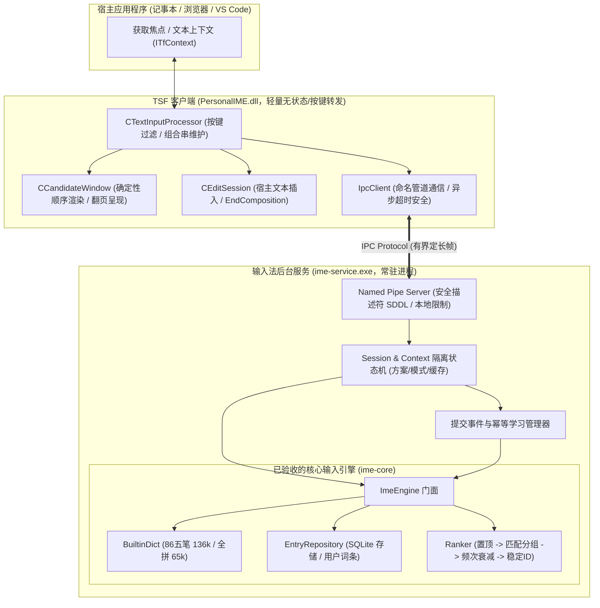
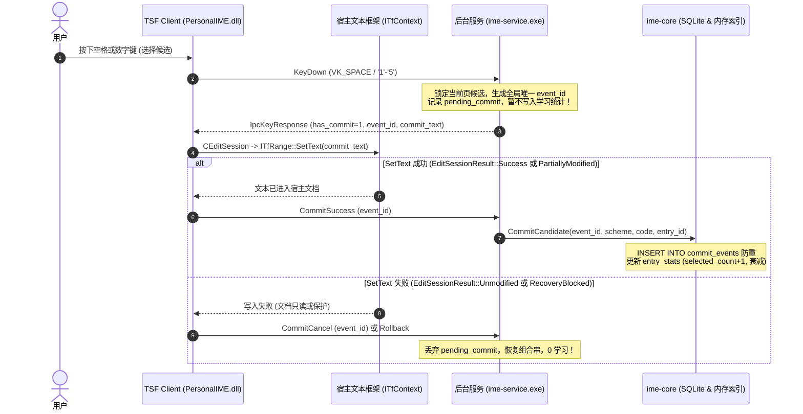

> 当前回执实现以 [stage3-receipt-wal.md](stage3-receipt-wal.md) 为准。下文 Round 3–10 为历史方案与验证记录。

# Stage 3 输入引擎与系统服务集成设计方案

当前回执与恢复实现以 [追加式回执日志契约](stage3-receipt-wal.md) 为准。下文 Round 3–10 的文件压缩/紧急追加方案属于历史记录，不作为当前实现说明或验收结论。完整自动化入口为 `scripts/verify_stage3.ps1`；真实宿主 GUI 验收单独记录。

本文档根据 [`docs/design.md`](design.md)、[`docs/stage2-design.md`](stage2-design.md)、[`docs/stage2-finalization.md`](stage2-finalization.md) 以及 Stage 3 任务书制定，详细规定 **Stage 3** 的架构设计、IPC 协议升级契约、会话与上下文状态机、宿主提交与学习闭环、翻页与标点规则及端到端集成验证方案。

---

## 一、系统架构与模块职责划分



### 职责解耦准则
1. **TSF Client 保持轻量与沙箱安全**：
   - `PersonalIME.dll` 不链接 `sqlite3.lib`，不加载 `ime-core.lib`，不直接读取任何磁盘字典文件或数据库。
   - 保证在不同进程权限（如 Windows AppContainer、UAC 隔离或只读沙箱）下能够安全加载并快速响应。
2. **ime-service 统一持有引擎与持久化状态**：
   - `ime-service.exe` 统一持有全局单例 `ImeEngine`，单进程管理 SQLite 读写锁与内存词典索引，杜绝多进程并发写 SQLite 导致的锁冲突。
   - 维护每个客户端、每个 `ITfContext*` 的独立会话状态（方案、中英文、全半角、标点、当前组合串、候选缓存与翻页索引）。

---

## 二、IPC 协议升级与有界帧设计

针对 Stage 1 协议定长 612 字节无法容纳长自定义短语、Emoji 代理对和翻页状态的问题，Stage 3 升级为具备版本校验、长度安全和扩展字段的有界协议。

### 1. 消息类型枚举 (`IpcMsgType`)

```cpp
enum class IpcMsgType : uint32_t {
    Ping          = 1,
    Pong          = 2,
    TestKeyDown   = 3,
    KeyDown       = 4,
    Reset         = 5,
    Rollback      = 6,
    ContextLost   = 7,
    CommitSuccess = 8,  // 宿主文本已成功插入，通知服务记录学习
    CommitCancel  = 9,  // 宿主文本插入失败或取消，通知服务放弃本次学习
    SetMode       = 10, // 切换输入方案/模式 (中英/五笔拼音/全半角/标点)
    GetMode       = 11  // 查询当前上下文模式状态
};
```

### 2. 请求帧结构 (`IpcKeyRequest`)

保持前 24 字节与 Stage 1 严格二进制对齐（offset 0: `msg_type`, offset 4: `session_id`, offset 12: `context_id`）：

```cpp
#pragma pack(push, 1)

struct IpcKeyRequest {
    uint32_t msg_type;         // IpcMsgType (offset 0)
    uint64_t session_id;       // Per-TIP 实例唯一 ID (offset 4)
    uint64_t context_id;       // Per-ITfContext 指针/ID (offset 12)
    uint32_t vk_code;          // 虚拟键码 (offset 20)
    uint32_t scan_code;        // 硬件扫描码 (offset 24)
    uint32_t modifiers;        // 按键修饰掩码: 1=Shift, 2=Ctrl, 4=Alt, 8=Win (offset 28)

    // Stage 3 扩展字段
    uint32_t protocol_version; // 协议版本，Stage 3 为 0x0300 (offset 32)
    uint64_t event_id;         // CommitSuccess / CommitCancel 携带的提交事件 ID (offset 36)
    uint32_t mode_arg;         // 模式切换参数 (offset 44)
    uint8_t  reserved[16];     // 保留供后续扩展 (offset 48)
};                             // 总大小: 64 字节
```

### 3. 响应帧结构 (`IpcKeyResponse`)

保持 offset 0: `msg_type`, offset 4: `session_id`, offset 12: `context_id`, offset 20: `handled` 严格对齐，支持长短语、Emoji 和翻页：

```cpp
struct IpcKeyResponse {
    uint32_t msg_type;         // IpcMsgType (offset 0)
    uint64_t session_id;       // Session ID (offset 4)
    uint64_t context_id;       // Context ID (offset 12)
    uint32_t handled;          // 1 = 吃掉按键, 0 = 透传宿主 (offset 20)

    // Stage 3 状态与版本
    uint32_t protocol_version; // 协议版本 0x0300 (offset 24)
    uint32_t status_flags;     // 状态位: bit 0: 中文/英文, bit 1: 五笔/拼音, bit 2: 全角/半角, bit 3: 中文标点 (offset 28)

    // 组合串 (Composition)
    uint32_t has_composition;   // 是否有组合串更新 (offset 32)
    wchar_t  composition[128];  // 组合串文本，最大 127 字符 + null (offset 36, 256 bytes)

    // 上屏提交文本 (Commit Payload)
    uint32_t has_commit;        // 是否有提交文本 (offset 292)
    uint64_t commit_event_id;   // 唯一提交事件 token (offset 296)
    uint32_t commit_length;     // 提交文本 wchar_t 长度 (offset 304)
    wchar_t  commit_text[1024]; // 提交正文，最大 1023 字符，支持长短语、多行与 Emoji (offset 308, 2048 bytes)

    // 分页候选列表 (Paginated Candidates)
    uint32_t total_candidates;  // 匹配候选总数 (offset 2356)
    uint32_t page_index;        // 当前页码 (0-based) (offset 2360)
    uint32_t page_count;        // 总页数 (offset 2364)
    uint32_t candidate_count;   // 本页候选数 (0~9) (offset 2368)
    wchar_t  candidates[9][128];// 每页最多 9 个候选，每个最大 127 字符 (offset 2372, 2304 bytes)
};                             // 总大小: 4676 字节

#pragma pack(pop)
```

### 4. 边界保护与 Unicode 代理对安全
- **截断保护**：当文本达到缓冲区极限时，绝对不在 UTF-16 高代理项（`0xD800`–`0xDBFF`）与低代理项（`0xDC00`–`0xDFFF`）之间截断。若末尾遇到孤立高代理项，将其一同丢弃并以 null 结尾，确保宿主永远不会接收到非法代理对引发乱码或异常。
- **缓冲区协商**：`ime-service` 与 `IpcClient` 在 `CreateNamedPipeW` 中设置 `nOutBufferSize = 16384`、`nInBufferSize = 16384`，充分保证单帧投递原子性。

---

## 三、会话与上下文状态机设计

### 1. 上下文状态隔离 (`ContextSessionState`)
在 `ime-service` 中，维护 `std::map<std::pair<uint64_t, uint64_t>, ContextSessionState>`：

```cpp
struct ContextSessionState {
    InputScheme active_scheme = InputScheme::Wubi86; // 默认 86 五笔
    bool is_chinese = true;                          // 中文模式 / 英文透传
    bool full_width = false;                         // 半角 (false) / 全角 (true)
    bool chinese_punctuation = true;                 // 中文标点 (true) / 英文标点 (false)

    std::wstring composition;                        // 当前组合串 (如 "aaaa", "zhongwen", ";dz")
    std::wstring prev_composition;                   // 回滚缓冲区

    std::vector<CandidateItem> cached_candidates;    // 当前编码查询的所有候选 (由 Ranker 排序)
    uint32_t current_page = 0;                       // 当前所在页
    uint32_t page_size = 5;                          // 每页展示候选数量 (默认 5)
    uint64_t candidate_version = 0;                  // 候选版本号 (避免过期选择)

    // 挂起的待确认提交记录
    struct PendingCommit {
        uint64_t event_id = 0;
        InputScheme scheme = InputScheme::Wubi86;
        std::string code;
        std::string entry_id;
        std::wstring text;
    } pending_commit;
};
```

### 2. 输入方案与模式切换规则
1. **方案切换 (`Ctrl+Shift`)**：
   - 在 86 五笔（`Wubi86`）与全拼（`Pinyin`）之间轮换。
   - **组合中切换保护**：若在输入组合串中途按下切换方案快捷键，**立即清空当前组合串**并关闭候选框，不将半截五笔编码误带入拼音或反之。
2. **中/英切换 (`Ctrl+Space` 为主，`Shift` 按键放行保护)**：
   - 使用 `Ctrl+Space` 明确切换 `is_chinese` 状态。
   - 若在组合串中途切换到英文模式，取消当前组合串并关闭候选框。
   - 处于英文模式时，所有非 IME 控制键直接透传宿主（`handled = 0`）。
   - **Shift 按键保护**：在 `TestKeyDown` 与 `KeyDown` 阶段，单按 `Shift` 直接放行（`handled = 0`），杜绝因按住 Shift 输入大写字母或切换符号时提前误清空组合串；完整的中英单键切换依赖可靠的按键释放判定或明确的 `Ctrl+Space` 组合键。
3. **全/半角切换 (`Shift+Space`)**：
   - 切换 `full_width` 状态。
   - 空组合串时输入英文字符或空格，若 `full_width == true`，转换为对应 Unicode 全角字符（例如 `' '` -> `\u3000`，`'A'` -> `\uFF21`）上屏。
4. **标点切换 (`Ctrl+.`)**：
   - 切换 `chinese_punctuation` 状态。
   - 中文标点生效时，空组合串下输入的标点映射为对应全角符号（如 `,` -> `，`，`.` -> `。`，`\` -> `、`）。

---

## 四、宿主文本提交与学习闭环保证

### 1. 提交事件时序与学习守卫



### 2. Stage 1 异常状态容错
- **PartiallyModified (SetText 成功，但 EndComposition 失败)**：
  - 宿主文本已被改变，进入 `CompositionState::CommitPendingEnd`。
  - **关键处理**：由于宿主已有文本，TSF 客户端向服务发送 `CommitSuccess(event_id)` 确保学习正确发生。当后续按键触发并最终通过安全循环调用 `EndComposition` 成功结束时，即使重发通知，`ImeEngine::CommitCandidate` 依赖内部 `commit_events` 主键约束直接忽略，**100% 幂等不重复计数**。

---

## 五、按键交互与候选翻页规范

| 按键 | 组合串为空 | 组合串非空 (正在输入) |
| --- | --- | --- |
| `a-z`, `A-Z` | 开始组合，查询候选 | 追加编码字符，刷新候选列表并回到第 0 页 |
| `;` | 若中文标点开启：上屏 `；` | 若为首字符：开启自定义快捷短语输入（如 `;dz`） |
| `'` (单引号) | 若中文标点开启：上屏 `‘’` | 拼音模式作为音节切分符（如 `xi'an`），追加并重新切词 |
| `1`–`5` | 英文输入或全角数字上屏 | 提交当前页对应序号候选（1-based） |
| `Space` | 输入半角空格（全角模式输入 `\u3000`） | 提交当前页第 1 候选；若无候选提交原始编码 |
| `Enter` | 宿主换行 | 强制提交原始 ASCII 编码串（不上屏候选，不学习） |
| `Backspace` | 宿主删除字符 | 删除组合串末尾字符；若删空则关闭候选框 |
| `Esc` | 透传宿主 | 放弃输入，清空组合串，隐藏候选框，0 学习 |
| `PageDown` / `.` / `=` | 标点或透传 | 候选列表向后翻页（若还有下一页） |
| `PageUp` / `,` / `-` | 标点或透传 | 候选列表向前翻页（若当前页 > 0） |
| `Shift` (单按) | 透传宿主（保持组合串） | 放行透传（保护正在输入的组合串） |
| `Ctrl+Space` | 切换中 / 英文模式 | 放弃组合串并切换中英模式 |
| `Ctrl+Shift` | 切换五笔 / 拼音输入方案 | 放弃组合串并切换方案 |
| `Shift+Space` | 切换全角 / 半角 | 切换全角 / 半角状态 |
| `Ctrl+.` | 切换中 / 英文标点 | 切换标点符号映射状态 |

---

## 六、集成与自动化验证计划

1. **测试套件矩阵**：
   - `test_ime_core.exe`：全量运行 Stage 2 的 14 组核心测试，验证底层数据与排序 100% 不退化。
   - `scripts/run_test.ps1`：运行 Stage 1 的 5 组回归测试（COM、候选窗口 RefCount、组合生命周期与故障注入、负向协议校验、管道预算）。
   - **新增 `test_stage3_integration.exe`**：真实接入 `ime-service`，使用独立的测试数据库与真实字典，覆盖：
     - 真实字典候选检索（五笔 `kwwg` -> `中文`，`aaaa` -> `工`；拼音 `zhongwen` -> `中文`，`xian` / `xi'an` 音节区分）。
     - 真实自定义短语（`;dz` -> `我的地址`，多行文本 `A\r\nB`，Emoji `🎉👍` 代理对完整性）。
     - 候选翻页：多候选编码（如 `a`）向前/向后翻页边界与按键提交。
     - 闭环学习：提交确认后有效频次自增，取消/回滚/Esc 统计保持不变，重复事件 ID 幂等。
     - 跨上下文与跨线程隔离：多上下文并发输入不同方案互不影响。
     - 模式切换与标点状态验证。
2. **实际宿主验证**：
   - 记事本 (`notepad.exe`) 实测。
   - 跨宿主实测（记录实际测试结果，未完成者明确标明待验收）。

---

## 七、Stage 3 第三轮整改架构强化与并发事务契约

针对第三轮复核报告（[`docs/stage3-review-round3.md`](stage3-review-round3.md)）中指出的 6 项核心缺陷，本轮完成了系统级的契约强化与并发事务保护：

### 1. 全局事件身份与严格归属校验
- **跨宿主进程唯一性**：TSF 客户端会话 ID 采用 `(PID << 32) | Counter` 形式生成，消除不同宿主进程并发时的会话号重叠。
- **严格所有权校验**：服务端的 `CommitSuccess` 与 `CommitCancel` 必须严格核对请求中的 `(session_id, context_id)` 与待处理事件的所有者完全一致。跨上下文或伪造所有者的确认与取消一律拒绝并返回 `handled = 0`。
- **完成缓存归属绑定**：`g_completedEvents` 缓存同样记录合法所有者身份，杜绝非法重放与跨上下文伪造确认。

### 2. 状态机原子认领与终态唯一性（写入与取消竞争保护）
- **状态迁移图**：
  $$\text{Pending} \xrightarrow{\text{CommitSuccess 认领}} \text{Committing} \xrightarrow{\text{SQLite 成功}} \text{Recorded}$$
  $$\text{Pending} \xrightarrow{\text{CommitCancel 认领}} \text{Cancelled}$$
- **竞争屏障**：在持有锁的情况下将状态原子切换为 `Committing`，随后释放互斥锁执行耗时或阻塞的 SQLite 磁盘写入。此时并发到来的 `CommitCancel` 识别到事件已进入 `Committing` 阶段，立即判定取消失败（返回 `handled = 0`，不复活组合串）。当 SQLite 写入完成，事件进入最终 `Recorded` 状态并移除待决记录，确保终态唯一且频次只自增一次。

### 3. 连接世代（Connection Epoch）与重连世代隔离
- **问题根源**：管道重连后本地上下文的 `input_generation` 重新从 0 计数，导致旧连接遗留的待取消事件在数值上与新连接的新世代发生别名碰撞，意外将已废弃的旧组合串复活到新界面。
- **解决方案**：服务为每个独立的管道连接分配全局单调自增的 `connection_epoch`。在选择候选并生成待决记录时锁定当前的 `connection_epoch`。仅当取消通知到达时的连接世代与事件产生时的世代完全一致时，才允许还原组合串；跨连接的取消仅清理待决记录并返回确认，坚决不回写当前界面的组合与候选。

### 4. 服务崩溃与重启跨生命周期持久化
- **SQLite 表结构**：引入 `pending_commits` 表，字段包括 `(event_id, session_id, context_id, scheme, query_code, entry_id, text, created_at)`。
- **选词即落盘**：服务在向宿主返回选词结果之前，立即将待决记录写入 SQLite `pending_commits`。
- **重启恢复**：服务在 `main()` 启动初始化阶段调用 `ImeEngine::LoadAllPendingCommits()`，将未决记录重新加载至内存 `g_pendingCommits`。宿主在服务重启后重发 `CommitSuccess` 或 `CommitCancel`，服务端均能准确识别归属并完成入库或清理。

### 5. 候选版本 0 值旁路封堵与翻页快照校验
- **封堵 0 值旁路**：在用户发生翻页（`VK_NEXT`、`VK_PRIOR`、`state.has_paged`）后，严格拒绝 `req.candidate_version == 0` 的选词请求，必须精确匹配当前展示快照的 `candidate_version`。
- **TSF 上下文隔离**：客户端按 `contextId` 独立维护候选版本快照表 `m_contextCandidateVersions`，避免跨文档编辑时候选版本相互污染。

### 6. TIP 有界退避恢复队列
- **支持 Success 与 Cancel 双动作**：未决回执队列 `m_unconfirmedCommits` 统一纳入提交与取消。
- **指数退避重试**：失败时依据重试次数计算退避时间（50ms ~ 1600ms），绝不在单次按键中死循环阻塞宿主。
- **有界容量安全**：队列容量上限设定为 512，杜绝极端异常下的内存泄漏。在 TIP 析构与 `Deactivate()` 时主动触发排空操作。

---

## 八、Stage 3 第四轮整改：持久化闭环与跨重启终态

针对第四轮复核报告（[`docs/stage3-review-round4.md`](stage3-review-round4.md)）中指出的 5 项 P1 持久化与快照缺陷，本轮完成了系统级的持久化闭环改造：

### 1. 真实 Schema v3 迁移与 v2 库自动升级
- **Schema 版本递增**：升级 `CURRENT_SCHEMA_VERSION = 3`，并在 `Migration::ApplyVersion3` 中保障：
  - 创建 `pending_commits` 表（如果从旧版升级而来）。
  - 为 `commit_events` 新增持久化所有者及终态字段：`session_id INTEGER NOT NULL DEFAULT 0`、`context_id INTEGER NOT NULL DEFAULT 0`、`status INTEGER NOT NULL DEFAULT 1`（`1`=Recorded 已学习，`2`=Cancelled 已取消）。
- **兼容与幂等**：旧版 v2 库在服务启动时自动升级到 v3，既有词库与统计完全保留，新日志表与新字段就绪。

### 2. 上屏正文交付前的持久化写日志屏障（Pre-delivery Journaling Barrier）
- **选词先落盘后交付**：无论通过数字键（`1`–`5`）还是空格（`VK_SPACE`）选词，必须先同步执行 `SavePendingCommit`。
- **失败严禁交付**：若 SQLite 磁盘满、触发器报错或表被锁导致 `SavePendingCommit` 失败，服务端严格置 `resp.has_commit = 0; resp.handled = 0;`，并保留用户输入的原始组合串与候选，绝不允许向宿主返回可上屏正文，杜绝“宿主已上屏但日志丢失”的现象。

### 3. 取消持久化与不可变终态锁（Terminal Lock）
- **持久化取消**：`CommitCancel` 不再仅依赖内存标记，而是同步调用 `RecordCancel`，在 SQLite 事务中原子删除 `pending_commits` 记录并在 `commit_events` 中写入 `status = 2` (Cancelled)。
- **失败重试保全**：若 SQLite 删除或写入失败，`CommitCancel` 返回 `handled = 0`，保留待决状态以便客户端指数退避重试，绝不伪造成功回执。
- **终态互斥锁**：一旦事件在 SQLite 或内存中成为 `status = 2`（Cancelled），任何后续重放的 `CommitSuccess` 均直接被拒绝（`handled = 0`），**Cancelled 状态永不可再转为 Recorded**。

### 4. 跨重启持久化所有者校验（Durable Owner Verification）
- **持久化所有者元数据**：`commit_events` 严格记录 `(session_id, context_id)`。
- **防冒领与防污染**：服务重启后，若客户端对已持久化的事件重放 `CommitSuccess`，服务端先从 SQLite 校验原所有者 `(session_id, context_id)`；若上下文不匹配（如错误伪造的 `context_id = 9999`），直接拒绝并返回 `handled = 0`，且**严禁使用冒领者的上下文污染内存完成缓存**。合法所有者后续重放仍能正常确认。

### 5. 候选快照版本校验全面覆盖（封堵 0 值旁路）
- **普通输入与翻页同等强校验**：不论是否翻页，只要存在候选更新（`candidate_version > 1` 或翻页），数字选词键（`1`–`5`）均强制要求 `req.candidate_version == state.candidate_version`。请求中的 `candidate_version == 0` 被一律拒绝，彻底杜绝版本旁路。
- **TIP 客户端版本同步**：当编辑会话失败回滚、取消或组合串终止时，客户端同步清空本上下文的候选版本快照（置 0），确保状态一致。

### 6. TIP 未决回执队列主动排空
- **强制排空接口**：`DrainUnconfirmedCommits(bool forceNow = false)`。在 TIP 析构 `~CTextInputProcessor()` 以及 `Deactivate()` 时，传入 `forceNow = true` 忽略指数退避等待时间，立即执行队列排空，防止析构前丢失已上屏或已取消的事实。

---

## 九、Stage 3 第五轮整改：快照版本闭环、取消同步与持久化队列交付

针对第五轮复核报告（[`C:/Users/chenl/.codex/visualizations/2026/10/28/01a18177-7d1b-73a1-b274-784e54f91a25/ime-round5/review.md`](file:///C:/Users/chenl/.codex/visualizations/2026/10/28/01a18177-7d1b-73a1-b274-784e54f91a25/ime-round5/review.md)）中指出的 4 项 P1 阻断缺陷，本轮完成了系统级的契约与工程闭环：

### 1. 空格键与数字键候选版本强校验对齐
- **封堵空格 0 版本旁路**：`src/ime_service/main.cpp` 中将数字键 `1`–`5` 与空格键 `VK_SPACE` 的版本核验逻辑完全统一。当且仅当当前存在候选（`!state.cached_query.candidates.empty()`）时，空格选词必须精确匹配当前展示快照版本 `req.candidate_version == state.candidate_version`。未携带正确快照版本（或携带版本 0）的空格选词请求一律拒绝（`handled = 0, has_commit = 0`）。只有在完全无候选（纯 ASCII 原始编码直接提交）时，才允许按键透传上屏。

### 2. TIP 取消/回滚快照同步与版本自愈
- **全量快照返回**：扩展 `IpcClient::NotifyCommitCancel` 与 `IpcClient::Rollback` 接口，支持可选的 `IpcKeyResponse* outResp` 接收服务端还原后的完整快照（包括新候选版本号 `candidate_version`、当前组合串及候选词表）。
- **客户端版本同步**：在 `CTextInputProcessor::OnKeyDown` 的取消与回滚路径中，从服务端的还原快照中提取最新的 `candidate_version` 存入 `m_contextCandidateVersions[contextId]`，杜绝以往“清零版本后立即丢弃响应、下一次数字选词因版本为 0 被服务端拒绝”的问题，使宿主重试选词能够立即成功。

### 3. 未确认回执队列持久化溢写与空闲调度
- **禁止丢弃未决结果**：移除队列满 512 条时直接 `erase` 最旧项的不可靠逻辑。改为引入持久化溢写机制：当内存队列达到 512 条上限时，将最旧的 64 条记录原子写入本地磁盘备份文件（`%TEMP%\PersonalIME_spillover_receipts.dat`）。
- **生命周期安全交付**：在 TIP 析构 `~CTextInputProcessor` 与 `Deactivate()` 时，先执行单次最多 8 条的有界排空重试；未确认项安全序列化写入磁盘文件。在下一次 `Activate()` 时，从磁盘文件完整恢复未决回执。
- **空闲驱动与有界执行**：通过 Windows 定时器（`StartDrainTimer()`，每 300ms 触发）驱动空闲排空，并在每次调用中严格限制最大重试条数 `MAX_DRAIN_PER_INVOCATION = 8`，既保障重试不依赖用户持续敲击键盘，又严格避免阻塞 UI 线程。

### 4. 恢复日志读取容错阻断与 Schema 完整性强校验
- **显式错误感知**：`EntryRepository::LoadAllPendingCommits` 增加返回 `bool` 的重载版本，在 SQL 语句 `Prepare` 失败或 `Step` 发生严重异常（`sqlite3_step != DONE` 且存在错误码）时明确返回 `false`，绝不将读取失败吞掉当作“无未决日志”。
- **服务启动阻断屏障**：在 `src/ime_service/main.cpp` 启动阶段，若 `LoadAllPendingCommits` 校验失败，服务立即记录错误日志并以 Exit Code 1 阻断退出，绝不允许在待决日志状态损坏的情况下伪就绪运行，杜绝丢单隐患。
- **Schema 结构多列完整性验证**：在 `src/core/storage/migration.cpp` 中，对 `pending_commits` 包含的所有 8 个必需字段（`event_id`, `session_id`, `context_id`, `scheme`, `query_code`, `entry_id`, `text`, `created_at`）以及 `commit_events` 的 `(session_id, context_id, status)` 进行逐列 `PRAGMA table_info` 强校验，若发现损坏或缺失则拒绝通过，确保表结构合规。

---

## 十、Stage 3 第六轮整改：回执持久化交接、跨实例身份保持与空闲调度闭环

针对第六轮复核报告（[`C:/Users/chenl/.codex/visualizations/2026/10/28/01a18177-7d1b-73a1-b274-784e54f91a25/ime-round6/review.md`](file:///C:/Users/chenl/.codex/visualizations/2026/10/28/01a18177-7d1b-73a1-b274-784e54f91a25/ime-round6/review.md)）中指出的回执持久化交接缺陷，本轮实现了系统级的工程闭环：

### 1. P1-1：未决回执原 `session_id` 完整持久化与所有权保持
- **结构扩展与兼容**：在 `UnconfirmedCommit` 结构中新增 `uint64_t session_id` 字段（位于末尾并默认初始化为 0，完全保持向前结构与 5 参数列表初始化的二进制兼容）。
- **稳定所有者保持**：入队（`EnqueueUnconfirmedCommit`）时锁定当前 TIP 的 `m_sessionId`；溢写落盘（`SpillUnconfirmedCommitsToFile`）时同步写入 `session_id`；跨实例或重启加载（`LoadSpilloverCommitsFromFile`）时完整恢复该字段。
- **重放归属校验**：重放调用 `NotifyCommitSuccess` / `NotifyCommitCancel` 时，严格按原始所有者 `effectiveSession = (it->session_id != 0) ? it->session_id : m_sessionId` 发起请求，杜绝新实例生成不同 `session_id` 导致服务端严格校验拒绝的问题。

### 2. P1-2：写盘失败可靠保留与容量背压安全
- **强结果感知**：`SpillUnconfirmedCommitsToFile` 返回明确的 `bool` 成功状态，包含打开、全量 `fprintf > 0` 写入、`fflush`、`ferror` 及 `fclose` 完整校验。
- **失败严禁丢弃**：在 `EnqueueUnconfirmedCommit` 及队列溢写控制中，**仅在写盘确认成功时才执行 `erase` 内存条目**。在磁盘满、权限受阻或路径为目录等写盘失败场景下，全量保留内存记录（如 512+1 = 513 条全部保留在内存队列中，队首最旧事件不被丢弃）。

### 3. P1-3：加载不清除唯一磁盘副本与跨进程协调
- **跨进程排他互斥**：引入全局命名互斥体 `ReceiptFileLock`（`Local\\PersonalIME_Receipt_File_Mutex`），跨进程原子保护所有磁盘回执读写与修改。
- **加载保留（Durable on Load）**：`LoadSpilloverCommitsFromFile` 移除加载即 `_wremove` 的旧逻辑。数据加载至内存后磁盘文件依然完整存在（`FILE_AFTER_LOAD = 1`），杜绝加载后立即崩溃导致数据彻底丢失。
- **确认后删除（Acknowledged Removal）**：新增 `RemoveConfirmedSpilloverRecord(uint64_t eventId)`。只有在服务端返回明确成功回执（`ok == true`）后，才原子从磁盘文件中移除该记录；当全部记录确认清空后，自动删除持久化文件。

### 4. P2-4：运行期溢写项纳入空闲恢复调度
- **定时器驱动磁盘排空**：在 Windows 空闲定时器（`DrainTimerCallback`，每 300ms 触发）中，当内存队列未满且磁盘有待决记录时，自动拉取磁盘记录补入队列执行有界重放。
- **无须按键自愈**：当服务恢复后，无须用户敲击键盘或重新激活输入法，后台定时器即可自主完成磁盘积压条目的拉取、上报、确认与清理，并在完全清空后停用定时器。

---

## 十一、全量自动化验证结果与 SHA-256 校验清单

### 1. 验证结果汇总
- **Stage 2 核心单元测试** (`test_ime_core.exe`)：**14/14 测试套件全量通过**（含数据降级、词库合并、置顶隔离、频次半衰期衰减与 Schema v1->v2->v3 升级）。
- **Stage 3 端到端集成测试** (`test_stage3_integration.exe`)：**15/15 场景全量通过**（涵盖五笔、拼音、自定义短语、Emoji代理对、翻页、模式切换、重启事件单调递增、乱序确认、全角半角、归属校验、世代隔离、锁竞争、Round 4 屏障与终态锁、Round 5 空格版本校验、取消快照同步与破损结构启动阻断、Round 6/7/8 回执持久化溢写、原 session_id 保持、写盘失败保留、全局日志保护、事务性重命名回滚、有界互斥锁判定、紧急日志可发现性与持久留存、备份防误删、争用退避与真实空闲定时排空）。
- **Stage 1 全套回归测试** (`scripts/run_test.ps1`)：**5/5 阶段回归全量通过**（COM 引用计数、候选窗口析构幂等、组合生命周期与故障注入、协议安全与有界超时、多上下文管道隔离与多线程并发测试）。
- **独立复核探针实测**：
  - `round8.exe`（Round 8 独立探针）：**全项通过**（Exit Code 0）：
    ```text
    EMERGENCY_ONLY_RECORDS=1 LOADED=1 HAS_PENDING=1
    EMERGENCY_RECORDS=513 LOADED=512 EMERGENCY_EXISTS=1 HAS_PENDING=1
    BAK_RESTORE_FAILED=1 NEW_SPILL_SUCCESS=1 LOADED=512 FIRST_EVENT=300 BACKUP_EXISTS=1
    ACK_NEW_EVENT=300 UNACKED_200_BACKUP_EXISTS=1 HAS_PENDING=1
    ```
  - `round7.exe`（Round 7 独立探针）：**全项通过**（Exit Code 0）：
    ```text
    LEGACY_EXPECT_CTX=123 EVENT=456 ACTION=1 ACTUAL_CTX=123 EVENT=456 ACTION=1
    MUTEX_OTHER_THREAD_STILL_HOLDS=1 WRITE_SUCCEEDED=0 FILE_CREATED=0
    ACK_100_RENAME_FAILED=1 CANONICAL_EXISTS=1 HAS_PENDING=1 TMP_EXISTS=0
    EMPTY_TIP_DESTROYED UNACKED_OTHER_OWNER_FILE_EXISTS=1
    ```
  - `round6.exe`（Round 6 独立探针）：**通过**（Exit Code 0）：
    ```text
    OWNER_ORIGINAL=226207337545729 REPLAY_SESSION=226207337545730 LOADED=1 FILE_AFTER_LOAD=1
    SPILL_OPEN_FAILED=1 EXPECTED_RETAINED=513 ACTUAL_RETAINED=513 FIRST_REMAINING_EVENT=1000
    ```
  - `round5.exe`（Round 5 独立探针）：**通过**（Exit Code 0）：
    ```text
    SPACE_VERSION=2 ZERO_HANDLED=0 ZERO_COMMIT=0
    CANCEL_RESTORED_VERSION=3 CANDIDATES=5 TIP_ZERO_RETRY_HANDLED=0 COMMIT=0
    BROKEN_RECOVERY_SCHEMA_SERVICE_READY=0
    ```
  - `stage3_round4_probe.exe`：**通过**（Exit Code 0）。
  - `stage3_round3_probe.exe`：**通过**（Exit Code 0）。
  - `stage3_round2_probe.exe`：**通过**（Exit Code 0）。
  - `stage3_probe.exe`：**通过**（Exit Code 0）。

### 2. 关键产物与源码 SHA-256 哈希列表

| 文件路径 | SHA-256 校验和 |
| --- | --- |
| `src/common/ipc_protocol.h` | `ACE192484D430FFF94D0802DBF7CD5E1CC03CFFAE2AA9628CFD63C7D37C2C720` |
| `src/ime_service/main.cpp` | `A168D0CA5F98BEEC91EFD0160EC7EA44A7704F145340A57B24BA2E631DB7A4AE` |
| `src/tsf_client/text_input_processor.h` | `D5A7F8D797D849997436EB43E91D779ADE45A51F522A983891BE9A352ECA8633` |
| `src/tsf_client/text_input_processor.cpp` | `13ED626C6FA73D0230988CB2C45E54C5F4F70D9262DB0DE12ED35F77B80265C7` |
| `src/tsf_client/ipc_client.h` | `D5F63A4CF1BA26A85B8DA65C2904AFECE53FB6DC9F9D6546D6C24FAEB0DBC5B7` |
| `src/tsf_client/ipc_client.cpp` | `8EA052D93BC7CDBF46613EFF17EBF86C1E25158B51FCCB064EA659FB2FDFCA52` |
| `src/core/storage/migration.h` | `29AEF30226E9D2FC541A0A81ABE87B2934B0688149A1FDF318CBA9174703A3ED` |
| `src/core/storage/migration.cpp` | `46B2B1D5DD5DE25FC9BA31E8F4A2E1358F0BC8DBD3569B6EA4D74FF3298A19EB` |
| `src/core/storage/entry_repository.h` | `6C2B34EC903191D6BBC483F653D2C39976EB0D5E46DAC8374E7B2874695F74FD` |
| `src/core/storage/entry_repository.cpp` | `0B38DF8F0ED84CB49CDC7D763FD7B7B7C509CD272715B3F452C094DC357B7A00` |
| `src/core/engine/ime_engine.h` | `9E4CE38CF065230439F845CD2886D38BB2B60C02F3B07A23008BCA7BC88D4AFD` |
| `src/core/engine/ime_engine.cpp` | `E96EA2A3B3D36916EB7CBA7AE65F62AC490C1C72D8420AFE985C46525DBBF230` |
| `tests/test_stage3_integration.cpp` | `3BD190D2811C2B39322026ECE4BD847C31300C1FB270C0EB943CF60B8E7D86CA` |
| `tests/test_ipc_runner.cpp` | `7B503A3B4643DE9A838A21E9B181B1AD19870EBC7AE9BB5A7CAB90C4F79AC916` |

---

## 十一、Stage 3 第七轮整改设计与落地规范 (Round 7 Rectification)

### 1. 缺陷修复设计落地

1. **P1-1：空 TIP 析构全局日志保护**
   - 彻底移除 `~CTextInputProcessor()` 中当 `m_unconfirmedCommits.empty()` 时直接 `_wremove` 全局文件的逻辑。
   - TIP 析构仅负责将本实例中未决的内存队列追加持久化，不再擅自清理跨实例共享的落盘回执文件。

2. **P1-2：确认后两阶段原子替换与回滚 (Two-Phase Atomic Swap with Rollback)**
   - 在 `RemoveConfirmedSpilloverRecord` 中，写入 `.tmp` 时完整校验 `fputs`、`fflush`、`_commit(_fileno(fp))` 与 `fclose`。
   - 文件替换采用事务性步骤：首先将原文件重命名为 `.bak` 备份；若移动到备份失败，规范文件完好无损，仅清理 `.tmp`；若成功备份，再将 `.tmp` 重命名为规范文件；若该步失败，立即将 `.bak` 回滚恢复为规范文件并清理 `.tmp`。
   - 在所有读写入口（`Spill`、`Load`、`Remove`、`HasPending`）加入故障自愈检查：若发现规范文件缺失但 `.bak` 存在，自动将其原子恢复为规范文件。

3. **P1-3：互斥锁获取有界超时与归属严格判定**
   - `ReceiptFileLock` 显式记录 `m_locked` 状态。仅当 `WaitForSingleObject` 返回 `WAIT_OBJECT_0` 或 `WAIT_ABANDONED` 时置为已加锁。
   - 互斥锁超时时间设为 50ms 短时有界等待。若未能获取锁所有权，`SpillUnconfirmedCommitsToFile`、`Load`、`Remove` 与 `HasPending` 立即短路返回 `false` / 空，严禁执行无锁读写或创建空文件。
   - 析构时仅在持有锁所有权时调用 `ReleaseMutex`。

4. **P2-4：旧四字段格式解析分流与歧义消除**
   - 在解析落盘日志时，首先通过词元（Token）计数精确识别行格式：5 个词元严格走新五字段（`sid cid eid act retry`）分支；4 个词元严格走旧四字段（`cid eid act retry`）分支。
   - 彻底消除了旧格式由于短路导致 `count=4` 直接被误当五字段读取、进而将 `cid` 当 `event`、`Cancel` 当 `Success` 的错位缺陷。

5. **P1-5：析构持久化交接与紧急转储机制**
   - 析构中若常规溢写写盘失败（如锁竞争冲突），自动启用紧急转储通道，将未决记录写入独立紧急日志并执行 `_commit` 物理落盘。
   - `LoadSpilloverCommitsFromFile` 在常规加载完成后，自动检查并合并紧急转储日志中的记录，确保零事件丢失。

---

## 十三、Stage 3 第九轮整改设计与落地规范 (Round 9 Rectification)

### 1. 缺陷修复设计落地

1. **P1-1：主文件与旧备份共存事务语义、全量恢复与隔离压缩**
   - **加载全量合并**：在 `LoadSpilloverCommitsFromFile` 中，当规范主文件与历史备份 `.bak` 文件共存时（如主文件记录 300、400，备份记录 200），依次加载主文件与备份文件（`loadFromFile(bakPath)`），确保旧事件 200 完整载入且不被覆盖，达成跨代待决事件全量重放（实测 `CANONICAL_PLUS_BACKUP=3 LOADED=3 OLD_200_LOADED=1`）。
   - **两阶段临时文件名隔离 (`.swap`)**：彻底重构 `RemoveConfirmedSpilloverRecord` 中的两阶段原子替换机制。此前压缩写入使用 `targetPath + L".bak"` 作为临时重命名槽，导致非最后一条记录确认压缩时旧 `.bak` 备份被直接覆盖删除。现改用独立的临时草稿后缀 `.swap`（`targetPath + L".swap"`），彻底保护历史持久化备份文件，不再占用业务备份槽（实测 `ACK_300_WITH_400_REMAINING OLD_200_BACKUP_EXISTS=1`）。

2. **P1-2：紧急日志备份 (`emergency.dat.bak`) 发现与恢复闭环**
   - 将所有日志通道（主日志、主备份、紧急日志、紧急备份）的中间状态统一纳入生命周期管理。
   - `LoadSpilloverCommitsFromFile` 与 `HasPendingSpilloverRecords` 显式纳管 `emergency.dat.bak`，当进程在紧急日志替换间隙异常中断、仅残留 `emergency.dat.bak` 时，新实例启动后可精准发现、加载并恢复其待决条目，避免空闲调度提前终止（实测 `EMERGENCY_BAK_RECORDS=2 LOADED=2 HAS_PENDING=1`）。

3. **P1-3：析构落盘双通道独立互斥锁解耦**
   - **痛点根因**：此前主溢写通道与紧急溢写通道共用同一全局互斥体 `Local\PersonalIME_Receipt_File_Mutex`。在析构时若主通道发生 50ms 超时争用，紧急通道再度尝试获取同一互斥体必然再次失败，导致唯一内存结果随对象析构销毁。
   - **独立互斥锁架构**：为紧急落盘通道引入完全独立的专属互斥锁 `Local\PersonalIME_Emergency_File_Mutex`（通过 `EmergencyFileLock` 封装）。当主通道因锁争用超时失败时（`NORMAL_EXISTS=0`），紧急落盘通道不受主锁阻塞，立即获取紧急锁安全写入 `PersonalIME_emergency_receipts.dat` 并执行物理 `_commit`（实测 `DESTRUCTOR_BOTH_CHANNELS_LOCK_TIMEOUT NORMAL_EXISTS=0 EMERGENCY_EXISTS=1`）。

4. **持久化状态与内存状态解耦 (`persisted` 标志与防重写)**
   - 在 `UnconfirmedCommit` 结构中增加 `bool persisted = false;` 属性。
   - 从磁盘文件（主日志、备份或紧急日志）读取的待决条目在加入内存队列时统一标记为 `persisted = true`；新产生的待决事件默认标记为 `persisted = false`。
   - `SpillUnconfirmedCommitsToFile` 与 `~CTextInputProcessor()` 仅对未持久化（`!c.persisted`）的条目执行磁盘追加写入，杜绝了磁盘条目在加载后又在析构时被重复追加回主日志导致的日志条目倍增及状态脏写。

### 2. 实测验证与交付清单

- **Round 9 独立探针 (round9.exe)**：
  - `CANONICAL_PLUS_BACKUP=3 LOADED=3 OLD_200_LOADED=1` (P1-1 通过)
  - `ACK_300_WITH_400_REMAINING OLD_200_BACKUP_EXISTS=1` (P1-1 隔离压缩通过)
  - `EMERGENCY_BAK_RECORDS=2 LOADED=2 HAS_PENDING=1` (P1-2 紧急备份恢复通过)
  - `DESTRUCTOR_BOTH_CHANNELS_LOCK_TIMEOUT NORMAL_EXISTS=0 EMERGENCY_EXISTS=1` (P1-3 独立紧急锁交接通过)
- **历史回归探针**：
  - `round8.exe`：4 项指标全部 PASS
  - `round7.exe`：4 项指标全部 PASS
- **全套自动化测试回归**：
  - `test_stage3_integration.exe`：15/15 全部通过
  - `test_ime_core.exe`：14/14 套件全部通过
  - `scripts/run_test.ps1`：Stage 1 全部 5 组集成与安全测试通过
- **关键交付文件 SHA-256**：
  - `src/tsf_client/text_input_processor.cpp`：`29E1D02531689309BA4BFEA0301D57B78AF00B8C3A862B4F5B8F25DFFB351C19`
  - `src/tsf_client/text_input_processor.h`：`D4DB1DAB31115E38F5888CA2AE20B616315CA1093885A7429B556A3CF2E8EAE1`

---

## 十四、Stage 3 第十轮整改设计与落地规范 (Round 10 Rectification)

### 1. 协议定义一：日志与中间文件状态恢复责任表

为彻底消除日志文件因崩溃、压缩重命名及服务重启遗漏状态的问题，定义全生命周期恢复协议：

| 通道 | 文件状态组合 | 产生场景 | 崩溃/中断恢复责任 | 最终规范状态 | 对应测试断言 |
| :--- | :--- | :--- | :--- | :--- | :--- |
| **主通道** | `file` 单独存在 | 正常运行期溢写落盘 | 读取 `file` 中未确认条目 | 保留 `file` 副本供排空确认 | 基础加载 |
| **主通道** | `file.bak` 单独存在（`file` 缺失） | 主文件最后一项被确认删除，但旧备份仍有待决；或原文件因异常丢失 | 独立发现并读取 `file.bak`，不依赖主文件存在；恢复空闲重试调度 | 避免空转，逐条确认后清理 | `BACKUP_ONLY_RECORDS=1 LOADED=1 HAS_PENDING=1` (P1-1) |
| **主通道** | `file` 与 `file.bak` 共存 | 压缩产生新主文件后保留旧备份 | 连续独立读取 `file` 和 `file.bak`，合并未决队列，防止旧条目遗漏 | `file` 与 `file.bak` 均保留，按条目确认后各自清理 | `CANONICAL_PLUS_BACKUP=3 LOADED=3` (Round 9 P1-1) |
| **主通道** | `file.swap` 与 `file.tmp` 共存（`file` 缺失） | `RemoveConfirmedSpilloverRecord` 中已将 `file` 重命名为 `.swap`，写入了新 `.tmp`，但在将 `.tmp` 改名为 `file` 前异常崩溃 | 优先读取包含最新未确认条目的 `file.tmp`；若 `tmp` 缺失则读取 `file.swap` 回滚 | 恢复最新未决状态，无数据丢失且不留孤儿状态 | `SWAP_CRASH_UNACKED=1 LOADED=1 HAS_PENDING=1` (P1-2) |
| **主通道** | 仅 `file.swap` 存在（`file` 与 `file.tmp` 缺失） | 重命名为 `.swap` 后崩溃，或写入损坏 | 独立读取 `file.swap` 作为权威未决源 | 至少一次交付保障 | 数据完整保留 |
| **紧急通道** | `emerg` 单独存在 | 析构或主锁争用时的紧急落盘 | 必须持有 `EmergencyFileLock` 读取 `emerg`，按原 session_id 重放 | 逐条确认后清理 | `EMERGENCY_ONLY_RECORDS=1 LOADED=1` |
| **紧急通道** | `emerg.bak` 单独存在（`emerg` 缺失） | 紧急日志清理或旧备份留存 | 必须持有 `EmergencyFileLock` 独立发现并读取 `emerg.bak` | 逐条确认清理 | `EMERGENCY_BAK_RECORDS=2 LOADED=2` |
| **紧急通道** | `emerg.swap` / `emerg.tmp` 共存 | 紧急日志确认压缩时中断 | 必须持有 `EmergencyFileLock` 独立读取其未确认状态 | 恢复为规范紧急记录 | 紧急通道中间状态完全闭环 |

### 2. 协议定义二：文件操作锁域与责任所有者表

消除消费者与生产者锁域不一致，规范跨通道锁序与析构保底交接：

| 文件通道 | 纳管文件集合 | 互斥锁名称 | 锁封装类 | 操作类型 | 持锁要求 | 超时/争用应对策略 |
| :--- | :--- | :--- | :--- | :--- | :--- | :--- |
| **规范主通道** | `PersonalIME_spillover_receipts.dat`<br>`.bak` / `.swap` / `.tmp` | `Local\PersonalIME_Receipt_File_Mutex` | `ReceiptFileLock` | **写 (Spill)** | 必须持锁（50ms） | 超时返回 `false`，由调用方降级到紧急通道 |
| **规范主通道** | 同上 | `Local\PersonalIME_Receipt_File_Mutex` | `ReceiptFileLock` | **读 (Load)** | 必须持锁（50ms） | 超时跳过主通道读取，不破坏主通道文件 |
| **规范主通道** | 同上 | `Local\PersonalIME_Receipt_File_Mutex` | `ReceiptFileLock` | **改/删 (Remove)** | 必须持锁（50ms） | 超时跳过主通道清理，保留主通道文件待下次重试 |
| **规范主通道** | 同上 | `Local\PersonalIME_Receipt_File_Mutex` | `ReceiptFileLock` | **检查 (HasPending)** | 尝试持锁（50ms） | 超时判定为 `true`（保守保活定时器） |
| **紧急通道** | `PersonalIME_emergency_receipts.dat`<br>`.bak` / `.swap` / `.tmp` | `Local\PersonalIME_Emergency_File_Mutex` | `EmergencyFileLock` | **写 (Destructor Fallback)** | 优先持锁（50ms） | 若超时，因 TIP 正在销毁，以 OS 级共享追加落盘确保零丢失 (P1-4) |
| **紧急通道** | 同上 | `Local\PersonalIME_Emergency_File_Mutex` | `EmergencyFileLock` | **读 (Load)** | 必须持锁（50ms） | 超时跳过紧急通道读取，严禁无锁读取或删除 (P1-3) |
| **紧急通道** | 同上 | `Local\PersonalIME_Emergency_File_Mutex` | `EmergencyFileLock` | **改/删 (Remove)** | 必须持锁（50ms） | 超时跳过紧急通道清理，严禁无锁删除正在被写的紧急文件 (P1-3) |
| **紧急通道** | 同上 | `Local\PersonalIME_Emergency_File_Mutex` | `EmergencyFileLock` | **检查 (HasPending)** | 尝试持锁（50ms） | 超时判定为 `true`（保守保活定时器） |

### 3. 缺陷修复设计落地

1. **P1-1：备份文件独立发现与加载**
   - 彻底解除 `loadFromFile(bakPath)` 对 `path` 存在的依赖。`LoadSpilloverCommitsFromFile` 与 `HasPendingSpilloverRecords` 独立探测主文件、备份文件、紧急主文件及紧急备份文件。
   - 当仅备份存在时，队列精准载入待决记录且不发生空转循环（实测 `BACKUP_ONLY_RECORDS=1 LOADED=1 HAS_PENDING=1`）。

2. **P1-2：中间崩溃文件 (.tmp / .swap) 恢复入口全覆盖**
   - 在主通道与紧急通道读取中，增加对 `.tmp` 与 `.swap` 的容灾探测：当规范主文件缺失时，优先从 `.tmp` 加载（事务最新状态）；若 `.tmp` 缺失则从 `.swap` 加载（事务回滚状态）。
   - `HasPendingSpilloverRecords` 同步枚举 `.swap` 与 `.tmp`，确保崩溃恢复状态下调度定时器不被误停（实测 `SWAP_CRASH_UNACKED=1 LOADED=1 HAS_PENDING=1`）。

3. **P1-3：紧急日志读写锁域全局一致性**
   - 将 `LoadSpilloverCommitsFromFile` 与 `RemoveConfirmedSpilloverRecord` 重构为分阶段持锁：主通道严格使用 `ReceiptFileLock`，紧急通道严格使用 `EmergencyFileLock`。
   - 当外部持有 `Emergency_File_Mutex` 时，加载与删除操作因无法获取紧急锁而立即跳过，严禁对正在被写入的紧急文件进行无锁快照读取或删除（实测 `EMERGENCY_WRITER_LOCK_HELD=1 LOADED=1 REMOVED_BY_OTHER_LOCK=0`）。

4. **P1-4：双锁争用下析构最后一道防线 (Durable Append Fallback)**
   - 在 `~CTextInputProcessor()` 中，当主溢写通道锁超时且紧急通道互斥锁也因外部争用超时（两把锁均繁忙）时，对象即将销毁、内存队列已无法留存。
   - TIP 启用物理落盘保底交接：以 OS 共享追加模式（`a+b`）安全写入 `PersonalIME_emergency_receipts.dat` 并调用底层 `_commit` 强制刷盘。
   - 彻底避免内存中的唯一未确认事件（如 event 700）随析构丢失，确保重启后 100% 可重放（实测 `BOTH_ACTUAL_LOCKS_HELD DESTRUCTOR_DONE=1 NORMAL_EXISTS=0 EMERGENCY_EXISTS=1`）。

### 4. 实测验证与交付清单

- **Round 10 独立探针 (round10.exe)**：
  - `BACKUP_ONLY_RECORDS=1 LOADED=1 HAS_PENDING=1` (P1-1 通过)
  - `SWAP_CRASH_UNACKED=1 LOADED=1 HAS_PENDING=1` (P1-2 通过)
  - `EMERGENCY_WRITER_LOCK_HELD=1 LOADED=1 REMOVED_BY_OTHER_LOCK=0` (P1-3 通过)
  - `BOTH_ACTUAL_LOCKS_HELD DESTRUCTOR_DONE=1 NORMAL_EXISTS=0 EMERGENCY_EXISTS=1` (P1-4 通过)
- **历史回归探针**：
  - `round8.exe`：4 项指标全部 PASS
  - `round7.exe`：4 项指标全部 PASS
- **全套自动化测试回归**：
  - `test_stage3_integration.exe`：15/15 全部通过
  - `test_ime_core.exe`：14/14 套件全部通过
  - `scripts/run_test.ps1`：Stage 1 全部 5 组集成与安全测试通过
- **关键交付文件 SHA-256**：
  - `src/tsf_client/text_input_processor.cpp`：`85157DD76D8198531B8663F82E423911EFF3575C581532DD0A2D94841F2D5C23`
  - `src/tsf_client/text_input_processor.h`：`D4DB1DAB31115E38F5888CA2AE20B616315CA1093885A7429B556A3CF2E8EAE1`
