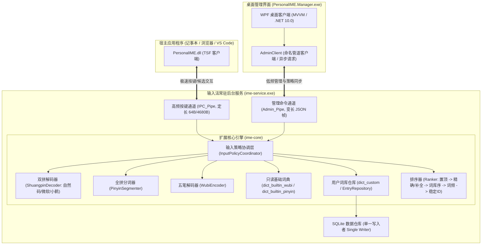

# Stage 4 输入策略协调层、双拼与 WPF 管理器设计方案

- 文档版本：3.0
- Stage 4A 最新验收：[核心自动化收尾报告](stage4a-finalization.md)。19 组策略专项及完整隔离回归通过。
- Stage 4B 最新验收：[独立收尾报告](stage4b-finalization.md)。Admin 15/15、真实服务集成 16/16、输入策略 19/19 及完整隔离回归通过；下一步执行 [Stage 4C WPF 任务书](stage4c-execution-prompt.md)，真实宿主验收仍待完成。
- 基线状态：基于 `feature/stage3` 自动化闭环，吸收并融合 [`docs/input-policy-design.md`](input-policy-design.md)、[`docs/design.md`](design.md) 与 [`docs/stage2-design.md`](stage2-design.md)。
- 目标运行库：C++20 核心服务（`ime-service.exe` / `ime-core.lib`） + .NET 10.0 Windows Desktop (WPF)，x64 架构。

---

## 一、系统架构与数据所有权划分

在前期 Stage 2（核心输入引擎）与 Stage 3（TSF 客户端与后台服务集成）中，已确立了以 `ime-service.exe` 常驻服务为核心的系统拓扑。Stage 4 在核心输入引擎之上增设**“输入策略协调层”（Input Policy Coordinator）**，统一管理输入方式解析、词库来源优先级、级联回退与自适应词频规则，并对外提供独立的管理命名管道供 WPF 客户端交互：



### 1. 单一数据所有权（Single Source of Truth）
- **后台服务独占存储**：`ime-service.exe` 是 SQLite 数据库（`personal_ime.db`）的唯一持有者与读写执行者。
- **管理器零直接存储访问**：WPF 管理界面 **严禁** 直接打开 SQLite 数据库文件。此举彻底消除：
  1. 多进程 SQLite 数据库文件锁争用（`busy_timeout`、`SQLITE_BUSY`、`not authorized` 权限冲突）；
  2. 管理器修改词条或策略后后台服务内存词库缓存未能实时感知失效的问题；
  3. 重复在 C# 中重新实现拼音分词、五笔拆字、双拼转换、衰减半衰期计算与排序算法导致的规则分歧。

### 2. 双物理命名管道隔离（Dual-Pipe Architecture）
- **高频按键通道**：`\\.\pipe\PersonalIME_IPC_Pipe`
  - 承载宿主应用的 `KeyDown`、`TestKeyDown`、`CommitSuccess`、`CommitCancel`。
  - 特点：微秒级响应、定长二进制帧（64B 请求 / 4680B 响应）、非阻塞。
- **低频管理通道**：`\\.\pipe\PersonalIME_Admin_Pipe`
  - 承载管理器的策略配置、词库增删改查、排序置顶、JSON 导入导出。
  - 特点：变长 UTF-8 JSON 结构、独立服务端线程池处理，**绝对不挤占按键响应与宿主打字流畅度**。
  - 当管理操作执行耗时较长的全量词库导入或数据库备份时，按键通道完全并行，不受其影响。

---

## 二、两个维度的正交解耦与核心概念

根据 [`docs/input-policy-design.md`](input-policy-design.md)，必须将“输入方式”与“词库来源”两个维度正交拆解，不混为一谈：

### 1. 输入方式（Input Method / Scheme Parser）
负责将用户原始击键按键序列（`raw_code`）解析为符合词典查询的规范编码或拼音音节（`resolved_code`）：
- **86 版五笔 (`Wubi86`)**：按五笔字型字根编码解析，长度 1~4 位 `[a-y]`。
- **全拼 (`Pinyin`)**：按汉语拼音音节（声母+韵母）切分，支持单引号音节分隔符 `'`。
- **双拼 (`Shuangpin`)**：两键输入一个音节（声母键 + 韵母键）。具备稳定 `layout_id`（如 `natural` 自然码、`ms` 微软双拼、`xiaohe` 小鹤双拼）。解码后输出拼音音节，**完全复用拼音词库**，无需复制一套独立的双拼词库！
- **自定义快捷编码 (`Custom`)**：如 `;dz`、`;dh`、`;bq`，直接映射用户特定短语、多行文本或 Emoji，独立于汉字编码解析。

### 2. 词库来源（Dictionary Provider）
拥有长期稳定的字符串标识符（`dictionary_id`），提供词条与编码映射：
- `dict_custom`：用户自定义词库（存储在 SQLite `user_entries`，支持用户维护、多编码绑定、特殊符号与多行）。
- `dict_builtin_wubi`：内置 86 版五笔词典（13.6 万词条，只读）。
- `dict_builtin_pinyin`：内置全拼词典（6.5 万词条，只读）。
- （未来可导入的外部第三方词库扩展点）。

---

## 三、输入策略协调层（Input Policy Coordinator）规则

### 1. 策略配置项与行为契约

| 设置项 | 类型与默认值 | 详细行为与约束 |
| :--- | :--- | :--- |
| `primary_input_method` | `Wubi86` / `Pinyin` / `Shuangpin` | 当前主要输入解析方式。 |
| `shuangpin_layout` | `natural` (默认) / `ms` / `xiaohe` | 当使用双拼时的键位映射方案，具备稳定 layout_id。 |
| `mixed_input_enabled` | `bool` (默认 `false`) | **混输开关**。关闭时仅按当前主要输入方式解析（自定义库按该方式匹配）；开启时允许跨启用的解析方式级联回退或联合检索。 |
| `dictionary_order` | `vector<string>` | **词库优先级列表**。默认：`["dict_custom", "dict_builtin_wubi", "dict_builtin_pinyin"]`。支持管理界面拖动排序、单独启用/禁用。 |
| `frequency_enabled` | `bool` (默认 `true`) | **词频优先开关**。开启时：个人频次、半衰期衰减与近期加分参与同层候选排序；关闭时：**仅冻结频次对排序的影响**（保持基础词序与手工顺序），保留历史统计数据，不改变已存储记录。 |
| `learning_enabled` | `bool` (默认 `true`) | **自适应学习记录开关**。与 `frequency_enabled` 独立。控制用户确认上屏后是否累计更新 `entry_stats`。 |
| `candidate_page_size`| `uint32_t` (默认 `5`，范围 5~9) | 每页候选词展示数量。 |

### 2. 级联检索规则（Cascading Fallback）
为解决“高优先级词库的长补全遮挡低优先级词库的精确词”问题，检索必须分为两个确定性阶段：

```text
阶段一：精确匹配组（Exact Match Group）
  按 dictionary_order 顺序逐一检索各词库的精确候选：
  1. 检索 dict_custom 精确匹配候选；
  2. 若当前输入方式支持，检索对应内置库精确匹配候选；
  3. 若启用混输，再检索下一输入方式的精确候选。
  ★ 如果在精确匹配组中召回了有效候选，立即结束检索并组装候选列表！

阶段二：前缀补全组（Prefix Completion Group）
  仅当阶段一在所有启用词库中均未命中任何精确候选时，才进入阶段二：
  按 dictionary_order 顺序逐一检索各词库的前缀补全/音节补全候选。
```
**关键边界**：
- **回退条件**：仅在“完全没有有效候选”时才触发回退到下一词库/解析器；如果当前词库已有有效匹配，不可直接丢弃。
- **宿主上屏失败绝不触发换词库**：若用户选中了某词条，但宿主文本框写入失败，必须沿用 Stage 3 已严格验证的持久化事务与重试恢复机制（`P1`/`R1` 回滚与恢复），**绝对不得自动换用另一个词重试插入**！
- **策略快照（Policy Revision）**：组合串（Composition）输入开始时立即锁定当前 `policy_revision`。打字过程中通过管理界面或快捷键修改设置，统一在下一次新组合开始时生效，保证正在展示的候选版本、翻页与选择绝对稳定。
- **词典归属验证与学习作用域分离**：双拼候选复用全拼词库，归属验证核对词条在 `Pinyin` 方案下的 `resolved_code`，而学习作用域与置顶偏好严格记录在 `Shuangpin` 方案和 `layout_id:raw_code` 独立键下，杜绝跨方案、跨布局作用域泄漏。
- **存储异常严禁伪装为无候选**：底层 SQLite 数据库异常（如表缺失或损坏）必须明确上报为 `CoordinatorStatus::StorageError`，严禁静默吞掉并错误触发向下一词库回退。
- **双拼严格输入校验与未完成键音节扩展**：非字母非法字符（如 `vs1`、`1`）直接拒绝为 `InvalidCode`；非法分隔符位置（如 `v'swf` 奇数截断）直接报错；未完成奇数尾声母（如 `vsw`）自动解析为该声母拼音前缀（`zhongw`），仅检索符合该声母音节的词条。
- **并发与无锁解码器**：协调层持有按布局预初始化的不可变解码器，查询调用零状态突变、零锁争用，确保新旧策略快照并发查询的绝对线程安全。
- **池外召回严格遵循精确优先阶段契约 (P1-1)**：`GetPinnedPreferences` 与 `GetActiveStats` 召回的候选统一接受阶段过滤。在精确匹配阶段（`exactOnly == true`），补全候选（`quality != MatchQuality::ExactFull`）严禁混入 `exactCache`，杜绝因高优先级词库的置顶/高频补全词遮挡后续词库真实精确匹配。
- **双拼池外召回方案与作用域对齐 (P1-2)**：双拼池外候选召回的偏好与统计索引读取严格采用 `(InputScheme::Shuangpin, layout_id:raw_code)` 作用域，词典定位与候选生成复用解码后的全拼编码，与提交记账的作用域分离保持绝对对称。
- **双拼音节边界强制约束 (P1-3)**：双拼按键对与显式分隔符确定的音节边界序列（如 `xi'an` -> `["xi", "an"]`）作为显式约束传递至词典层（`QueryPinyinExplicit` 与 `CheckPinyinItemMatchesSyllables`）。仅保留音节边界完全吻合的词条，彻底杜绝同形连续串跨音节混杂（如 `xi'an` 错误召回单音节 `xian`）。
- **有界歧义解码与工作量上限防护 (P1-4 & P2)**：双拼解码器设置最大分支上限（`MAX_SHUANGPIN_BRANCHES = 16`）与输入长度硬限制（`MAX_SHUANGPIN_INPUT_LENGTH = 64`）。截断标记仅在真正遇到第 17 条未访问独特分支时触发，恰好 16 条有效分支不误报截断。
- **解析截断状态与预算上报传播 (Round 3 P1-2)**：解码器截断状态完整传递至 `CoordinatorQueryResult`（`is_truncated` 与 `truncation_reason`）。当由于分支预算耗尽导致候选为空时，协调层明确返回 `CoordinatorStatus::BudgetTruncated`（5），严禁静默伪装为 `NoCandidates`（1）；超长输入明确返回 `CoordinatorStatus::InputLengthExceeded`（6），与普通语法错误清晰区分。
- **自定义词库音节边界契约与无正文长度启发 (Round 3 P1-1)**：彻底删除正文长度过滤（支持特殊符号 `★`、多行文本与 Emoji）。自定义词库编码解析严格遵循汉语拼音正词法契约：带分隔符编码（如 `xi'an`）保留显式边界；未分隔编码（如 `xian`）采用贪心最长规范音节切分（`{"xian"}` 单音节，不与 `xi'an` 混淆）；查询、归属校验（`VerifyCandidateAffiliation`）与提交学习复用完全一致的音节解析契约。
- **全拼未完成前缀多音节补全契约 (Round 4 P1-1)**：全拼解析器不仅支持完整音节切分，当用户输入尚未成型的前缀字母（如 `z`、`zhongw`）时，精确分解为有效音节前缀与末尾未完成声母（`trailing_initial`），使多音节自定义词条（如 `zhongwen`）在前缀输入阶段即可被稳定检索召回。
- **多编码映射独立保全与最佳质量归并 (Round 4 P1-2)**：`QueryUserCandidates` 底层以 `entryId + ":" + matchedCode` 建立唯一映射，杜绝同词条多编码（如同时绑定 `xian` 与 `xi'an`）在数据库底层被过早去重丢弃；协调层在各词库内部按 `entry_id` 维护最佳质量映射，优先保留并晋升为 `ExactFull`。
- **归属合法性校验严格杜绝反向前缀 (Round 4 P1-3)**：`VerifyCandidateAffiliation` 彻底剔除反向包含判断（`cleanCode.rfind(rCode, 0) == 0`），仅允许完全相等或正向编码补全（`rCode.rfind(cleanCode, 0) == 0`），彻底杜绝五笔短码（如 `a`）通过超长输入（如 `abcd`）的归属合法性校验。
- **语法强校验前置杜绝非法数字伪装 (Round 4 P2)**：全拼解析前置执行 `IsValidCode(InputScheme::Pinyin, rawCode)`，纯数字串（如 `123`）直接判定为 `CoordinatorStatus::InvalidCode`（4），杜绝因分词器字面量回退机制被误判为“无候选”（1）。

### 3. 排序层次结构
候选列表呈现严格遵循分层规则：
```text
1. 用户手工固定/置顶候选 (Pinned / Manual Rank) —— 最高优先级，不可被词频打乱
2. 匹配质量 (ExactFull > PrefixFull > PrefixCompletion)
3. 输入方式优先级 (根据 input_method_order 配置，主要方式 0 > 混输后续方式 1, 2...)
4. 个人词频与衰减加分 (当 frequency_enabled == true 时生效；内置词加载 personal stats)
5. 基础词典默认词序 (当 frequency_enabled == false 时完全保持稳定)
6. 稳定词条 ID (消除平局跳动)
```

---

## 四、管理 IPC 协议契约（Admin IPC Protocol）

### 1. 传输层定长帧头设计 (Exact 16-Byte Header)
管理命名管道 `\\.\pipe\PersonalIME_Admin_Pipe`（`IME_ADMIN_PIPE_NAME`）采用标准 16 字节二进制定长头 + 变长 UTF-8 JSON Payload：

```text
+-----------------------+--------------------+--------------------+--------------------+--------------------------------+
| Magic (4 Bytes)       | Version (4 Bytes)  | Length (4 Bytes)   | RequestId (4 Bytes)| Payload JSON Data (N Bytes)    |
| 0x50, 0x49, 0x4D, 0x41| uint32_t (0x0100)  | uint32_t (N<=16MB) | uint32_t           | UTF-8 Encoded JSON String      |
+-----------------------+--------------------+--------------------+--------------------+--------------------------------+
```
- **Magic (4 字节)**：`ADMIN_MAGIC_BYTES = {'P', 'I', 'M', 'A'}`（字节序为 `0x50, 0x49, 0x4D, 0x41`，ASCII `"PIMA"`）。
- **Version (4 字节)**：小端序 `uint32_t = 0x0100`（主版本 1，次版本 0）。
- **Length (4 字节)**：小端序 `uint32_t = payload_length`，单次 Payload 上限为 16MB（`MAX_ADMIN_PAYLOAD_SIZE = 16 * 1024 * 1024`）。
- **RequestId (4 字节)**：小端序 `uint32_t = request_id`，客户端生成，服务端在响应头中原样回传，便于异步客户端并发请求关联。
- **结构体静态断言**：`static_assert(sizeof(AdminHeader) == 16, "AdminHeader must be exactly 16 bytes");`。
- **安全描述符（SDDL）**：`D:(A;;GA;;;userSid)(A;;GA;;;BA)(A;;GA;;;SY)`，严格限制为当前登录用户 SID、Built-in Administrators 与 Local System，**严禁添加 AppContainer 权限（`AC`）**，彻底隔绝低完整性 UWP / 沙箱进程。

### 2. 错误码规范（AdminErrorCode）

| 错误码 | 名称 | 场景说明 |
| :--- | :--- | :--- |
| `1001` | `InvalidMagic` | 帧头 Magic 不匹配 `"PIMA"` |
| `1002` | `UnsupportedVersion` | 协议版本非 `0x0100` |
| `1003` | `PayloadTooLarge` | Payload 长度超过 16MB |
| `1004` | `InvalidJson` | JSON 格式错误或解析异常 |
| `1005` | `UnknownAction` | 请求 action 未知 |
| `1006` | `MissingParameter` | 必填字段缺失或空 |
| `1007` | `ValidationFailed` | 策略值或词条参数不合法（如 pageSize 不在 5..9、非法方案） |
| `2001` | `EntryNotFound` | 指定词条 ID 不存在 |
| `3001` | `StorageError` | SQLite 底层执行或写入失败 |
| `3002` | `Busy` | 目标词条存在未确认的在途提交（in-flight pending commit），或整库替换导入时存在在途提交，拒绝操作以保护 Stage 3 收据恢复 |
| `4001` | `RevisionConflict` | 乐观锁版本冲突（`expected_revision` 与当前实际 revision 不匹配） |

### 3. API 操作清单（12 项核心接口）

| Action | 请求参数 | 关键契约与保护 |
| :--- | :--- | :--- |
| `GetStatus` / `ping` | 无 | 返回 `service_version`、`uptime_seconds`、`current_revision`、`active_connections`。 |
| `GetPolicy` | 无 | 返回当前生效的完整 `InputPolicy` JSON。 |
| `SavePolicy` | `{"policy": {...}, "expected_revision": N}` | 校验参数（页码 5..9，合法布局与词库）。支持 `expected_revision` 乐观并发控制，冲突返回 `4001`；成功 revision + 1 并落盘 SQLite `meta_settings`。 |
| `GetEntries` | `{"keyword": "...", "scheme": "...", "page": 0, "page_size": 20}` | 分页查询自定义词库，支持多音节前缀模糊检索与指定输入方式过滤。 |
| `AddEntry` | `{"text": "...", "codes": [{"scheme":"...", "code":"..."}]}` | 新增自定义词条。支持多编码绑定、特殊符号、Emoji 与多行短语（`\n`）。 |
| `UpdateEntry`| `{"entry_id": "...", "text": "...", "codes": [...]}` | 修改词条。**在途提交保护**：若该词条存在未确认提交，返回 `Busy (3002)` 拒绝更新。 |
| `DeleteEntry`| `{"entry_id": "..."}` | 删除词条。**在途提交保护**：若存在未确认提交返回 `Busy (3002)` 拒绝删除。级联清理对应置顶。 |
| `SetPin` | `{"scheme": "...", "code": "...", "entry_id": "...", "is_pinned": bool, "rank": int}` | 独立置顶/取消置顶，作用域严格绑定 `scheme`、`layout_id` 与 `code`。 |
| `ReorderPinned` | `{"scheme": "...", "code": "...", "entry_ids": ["id1", "id2", ...]}` | 批量原子重排置顶顺序。一次事务中重置并赋予顺序位次。 |
| `ResetStats` | 无 | **晚到 ACK 习惯保护**：清空 `entry_stats`，记录 `last_reset_stats_at = Now()`。晚于重置到达的旧提交虽照常落盘收据，但严禁在 `entry_stats` 唤醒旧频次。 |
| `ExportData` | `{"file_path": "..."}` | 导出版本化 JSON 词库与元数据（schema_version: "1.0"）。 |
| `ImportData` | `{"file_path": "...", "replace_mode": bool}` | 导入词库。`replace_mode=true` 时若存在任何在途提交，返回 `Busy (3002)` 拒绝覆盖。 |

---

## 五、WPF 词库与设置管理器界面设计

### 1. 技术栈选型
- **目标环境**：.NET 10.0 (`net10.0-windows`)，采用 x64 单一可执行文件或标准发布。
- **界面架构**：WPF 原生控件 + MVVM 架构，现代扁平风格样式，零重型第三方依赖。

### 2. 核心功能视图规划

#### 视图一：输入策略与偏好设置 (Policy & Preferences View)
- **输入方式与双拼**：
  - 主要输入方式：`86版五笔` / `全拼` / `双拼`。
  - 双拼方案下拉选择（当且仅当选择双拼或开启混输双拼时可用）：`自然码`、`微软双拼`、`小鹤双拼`。
  - 混输开关：`开启多方案智能回退/混输`。
- **词库优先级与开关（支持拖动/上下移动排序）**：
  - 🗂️ `用户自定义词库` [启用]
  - 🗂️ `内置五笔词典` [启用]
  - 🗂️ `内置全拼词典` [启用]
- **自适应学习控制**：
  - `词频优先排序` 开关（关闭时仅冻结频次对顺序的影响，保留历史数据）。
  - `记录用户选词习惯` 开关。
- **通用输入参数**：
  - 候选词数量滑块：`5 ~ 9`。
  - 初始状态：中文/英文、中文标点/英文标点、半角/全角。

#### 视图二：词库管理 (Wordbook View)
- **搜索与展示**：顶部搜索栏，支持实时过滤。`DataGrid` 展现词语、拼音码、五笔码、置顶标志、使用次数。支持多行短语与 Emoji 渲染。
- **编辑操作**：新增/编辑词条弹窗（编码合法性校验：五笔 1~4 位 `[a-y]`、拼音音节切分）。右键置顶、清空单词频次、删除。

#### 视图三：维护与备份 (Maintenance View)
- **版本化 JSON 导入/导出**：支持合并导入（Merge）与覆盖导入（Replace）。
- **清空学习记录**：二次确认弹窗，一键清空全部词频统计（完整保留自定义词条与置顶）。
- **常驻服务状态**：服务运行状态绿灯/红灯，支持一键重启输入服务。

---

## 六、分阶段实施路线（Stage 4A → 4B → 4C）

为确保每一步都有严格的自动化测试证据，按以下三阶段顺序实施：

### 阶段 1：Stage 4A —— 输入策略协调层与双拼解析 (ime-core)
1. **实现双拼解码器**（`src/core/encoding/shuangpin_decoder.h/.cpp`）：
   - 支持 `natural`（自然码）、`ms`（微软双拼）、`xiaohe`（小鹤双拼）三种主流键位映射；
   - 健壮将 2 字符输入映射为规范全拼音节并接入拼音分词器。
2. **实现输入策略协调层**（`src/core/strategy/input_coordinator.h/.cpp`）：
   - 策略配置结构 `InputPolicy`（含混输、双拼方案、词库优先级、词频开关、学习开关）；
   - 两阶段级联检索：先各词库 Exact Match，再各词库 Prefix Completion；
   - 词频开关支持（`frequency_enabled` 关闭时屏蔽个人频次项，保持基础词序与手工置顶）；
   - 策略版本快照机制。
3. **编写自动化测试**（`tests/test_input_policy.cpp`）：
   - 覆盖：混输开启/关闭隔离、双拼解码与拼音词库复用、自定义精确优先、前缀补全不遮挡下一库精确候选、词频关闭排序稳定、手工置顶不可动摇、同文多来源单次学习。

### 阶段 2：Stage 4B —— 管理接口与服务集成 (ime-service & Admin IPC) [已完成]
1. **定义管理协议**（`src/common/admin_protocol.h`）：
   - 16 字节定长帧头 `ADMIN_MAGIC_BYTES = "PIMA"`、版本 `0x0100`、`payload_length`、`request_id`。
   - 定义 11 类 `AdminErrorCode` 错误码（1001~4001）。
2. **在 `ime-service` 中实现管理服务端**（`src/ime_service/admin_server.h/.cpp`）：
   - 监听独立命名管道 `\\.\pipe\PersonalIME_Admin_Pipe`（BYTE 模式 + `ReadExact` 强流控）；
   - SDDL 严格限定为当前用户 SID，物理隔离按键通道，排除 AppContainer `AC`；
   - 完整实现 12 项管理 Action（`GetStatus`、`GetPolicy`、`SavePolicy`、`GetEntries`、`AddEntry`、`UpdateEntry`、`DeleteEntry`、`SetPin`、`ReorderPinned`、`ResetStats`、`ExportData`、`ImportData`）；
   - 在途提交 Busy 保护（`3002`）与晚到 ACK 词频防复活保护。
3. **完成服务集成与策略快照不可变性**（`src/ime_service/main.cpp`）：
   - 组合输入期间锁定不可变 `policy_snapshot`；
   - 支持动态 5..9 候选页码全链路（按键选择 1..9、翻页计算）；
   - 支持手动切库（`IpcMsgType::NextDictionary` 与 `VK_TAB`）。
4. **管理 IPC 专项自动化测试闭环**（`tests/test_admin_ipc.cpp`）：
   - 10 组专项测试 10/10 全部通过，回归全套 0 错误。

### 阶段 3：Stage 4C —— WPF 桌面管理器 (PersonalIME.Manager) [待开展]
1. 在 `src/manager/PersonalIME.Manager/` 创建 .NET 10.0 WPF 桌面客户端工程。
2. 实现命名管道异步通信服务（`AdminPipeClient.cs`），对齐 16 字节帧头与 JSON 协议。
3. 构建 MVVM 视图：策略与偏好设置页（词库拖动排序）、词库管理页（增删改查/置顶/Emoji）、维护与备份页（JSON 导入导出/清空记录）。
4. 全流程端到端联动验收。
