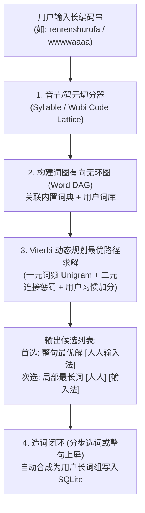

# Stage 6 产品与技术成熟方案：智能反查补全、键鼠选词交互与长词短句引擎

本文档针对 **人人 (RenRen IME)** 下一阶段的三大核心体验升级，结合搜狗、Rime (中州韵)、微软五笔/拼音等成熟输入法的工业级最佳实践，给出完整、可直接落地的产品交互与技术架构方案。

---

## 一、 特性 1：少候选跨方案智能补全与反向编码提示（以拼助五 / 边打边学）

### 1.1 痛点与产品目标
在“五笔为主、拼音为辅”或“双拼为主、五笔为辅”的场景中：
- 当用户输入一串编码（如忘记五笔怎么拆，直接输入了拼音 `quanpin`，或五笔某前缀下仅有 1~2 个生僻字），主方案候选不足。
- 如果此时不仅能自动用次级方案（如全拼/双拼）补齐候选词，还能在补齐的候选词旁 **直接标注出它的主方案编码**（例如：`1. 全屏 [wgu]  2. 全凭 [wgn]`），用户既能立刻完成输入，又能在潜移默化中记住五笔编码。

### 1.2 成熟交互与触发规则
1. **可配置触发阈值 (`fallback_candidate_threshold`)**：
   - 在 `InputPolicy` 与“输入设置”界面新增配置项：**“次级方案补全阈值”**（默认值：`3`，范围 `0 ~ 9`，设为 `0` 表示仅在主方案 0 候选时兜底）。
2. **分层召回与去重融合**：
   - **Step 1（主方案召回）**：优先使用当前主输入方案（`primary_input_method`，如 `wubi86`）检索。
   - **Step 2（阈值判定）**：若主方案返回的候选词数量 `< fallback_candidate_threshold`（如 `< 3` 个），则按 `input_method_order` 依次调用已启用的次级方案（如 `pinyin` / `shuangpin`）检索。
   - **Step 3（编码反查标注）**：对所有来自 **次级方案** 的候选词，自动调用内核 `ReverseLookup(candidate.text, primary_input_method)`：
     - 若查到主方案简码/全码（如 `全屏` -> `wgu`），则生成带提示的展示文本：`全屏 [wgu]`。
     - 若为多字未登录词，则展示单字拆解编码或优先展示四码组合码。
   - **Step 4（保序合并）**：主方案原生候选排在最前，次级方案补充候选紧随其后（自动按 `text` 去重）。
3. **视觉呈现（复用并增强 `CCandidateWindow`）**：
   - 当前 [`CCandidateWindow`](file:///c:/Projects/AITools/PersonalIME/src/tsf_client/candidate_window.cpp) 已经预留了对 `[` 括号后缀的副字体 (`m_hSubFont`, 浅灰 `#9CA3AF`) 渲染逻辑！
   - 只需将次级候选格式化为 `词条 [反查码]`，候选窗即可原生呈现 **“深色主词条 + 浅灰小字号编码提示”** 的精致视觉效果。

---

## 二、 特性 2：候选词方向键导航与鼠标直选交互

### 2.1 痛点与产品目标
目前候选框默认高亮第 1 个候选词（按空格上屏第 1 项，按数字键 `1~9` 上屏对应项）。但在实际桌面使用中：
- 用户习惯用 **方向键** 移动高亮游标，然后直接按 **空格 (`Space`)** 或 **回车 (`Enter`)** 上屏。
- 用户习惯用 **鼠标直接点击** 候选框中的第 2、第 3 个词直接上屏，或用 **鼠标滚轮** 翻页。

### 2.2 成熟键鼠交互方案（主流输入法标准规范）

| 操作方式 | 行业标准行为规范 | 边界与焦点安全处理 |
| :--- | :--- | :--- |
| **左右/上下方向键** | **模式 A（推荐默认）**： • `↓` / `↑`（或 `→` / `←`）：在当前页候选词 `1 ~ N` 之间循环移动高亮焦点 (`selected_index`)。 • 当 `selected_index` 在页末继续按 `↓` 时，自动翻到下一页并选中第 1 项；在页首按 `↑` 时翻回上一页末项。 • `-` / `=` 与 `PageUp` / `PageDown`：整页上下翻页。 | 方向键仅在 `IsComposing() == true` 时由 TSF `OnTestKeyDown` 拦截，非打字状态下 100% 透传给宿主编辑器。 |
| **空格 (`Space`)** | 上屏当前高亮选中的 `selected_index` 候选词（不再死板固定为第 0 项）。 | 提交后重置 `selected_index = 0`。 |
| **鼠标悬停 (Hover)** | 鼠标移入第 `i` 个候选词矩形区域 (`m_candidateRects[i]`) 时，显示浅蓝灰悬停背景，手型光标 (`IDC_HAND`)。 | 保持 `WS_EX_NOACTIVATE` + `MA_NOACTIVATE`，绝不抢走宿主窗口焦点。 |
| **鼠标左键点击** | • **单击候选词 `i`**：立即将该候选词上屏（调用 `CommitCandidateAtIndex(i)`）并关闭候选框。 • **滚轮滚动 (`WM_MOUSEWHEEL`)**：向上滚动翻上一页，向下滚动翻下一页。 | 通过 TSF 异步/同步 `ITfEditSession` 安全写入宿主文档并记录习惯学习回执。 |

### 2.3 技术实现路径
1. **候选窗 (`CCandidateWindow`)**：
   - 新增 `int m_selectedIndex = 0` 与 `int m_hoveredCandidateIndex = -1`，以及 `std::vector<RECT> m_rcCandidates`。
   - 在 `WM_PAINT` 中：原本仅对 `i == 0` 绘制的深蓝高亮胶囊（`RGB(0, 102, 204)`），改为对 `i == m_selectedIndex` 绘制高亮胶囊；对 `i == m_hoveredCandidateIndex` 绘制浅灰蓝悬停底色。
   - 在 `WM_LBUTTONUP` 中：若命中 `m_rcCandidates[i]`，触发回调 `m_onSelectCandidate(i)`。
2. **TSF 客户端 (`CTextInputProcessor`)**：
   - 维护当前页高亮索引 `m_selectedCandidateIndex`。
   - 拦截 `VK_UP` / `VK_DOWN`（或 `VK_LEFT` / `VK_RIGHT`）更新 `m_selectedCandidateIndex`，或通过 IPC 发送 `SelectCandidate` / `ChangePage`。
   - 鼠标点击回调触发 `RequestEditSession` 将对应候选词直接上屏。

---

## 三、 特性 3：长词组与短句整句输入引擎（DAG 动态规划 + 造词记忆）

### 3.1 痛点与产品目标
当前引擎主要面向 **单字与词典内已有词组** 的匹配：
- 当用户输入词典中不存在的组合长词或短句（例如连续输入拼音 `renrenshurufa` 期望打出 `人人输入法`，或 `jintianshiyigehaorizi` 期望打出 `今天是一个好日子`，或五笔连续输入多个词根），若词库中没有整条短句，前缀补全无法拼出完整句子。
- 目标：在保持 **本地轻量化（内存占用 < 30MB，检索延迟 < 2ms）** 的前提下，实现媲美主流输入法的 **整句切分、智能组句与自学习造词**。

### 3.2 成熟三级架构方案

#### 第一层：构建编码有向无环图 (Word Lattice / DAG)
1. **拼音音节图与简拼支持**：
   - 将连续拼音串切分为音节序列 $S_1, S_2, \dots, S_k$（同时支持声母简拼，如 `rrsrf` -> `r'r's'r'f`）。
   - 对任意区间 $[i, j]$（$1 \le j - i + 1 \le 8$），在 `BuiltinDict` 与 `UserDict` 中查找匹配的子词，构成图中的有向边 $E(i \to j, \text{word}, \text{score})$。
2. **五笔四码定长与词组切分**：
   - 当五笔输入长度 $> 4$ 时，支持按 4 码边界（或词库全码匹配）自动切分为多段，构建五笔短句图。

#### 第二层：Viterbi 动态规划整句解码
无需引入几百 MB 的重型神经网络，采用经典的 **最少词数惩罚 + 最大对数概率 (Log-Probability Viterbi)** 即可达到极佳的日常短句准确率：
$$\text{Score}(W_1, W_2, \dots, W_m) = \sum_{k=1}^{m} \left( \ln(\text{Freq}(W_k) + 1) + \text{UserBoost}(W_k) \right) - \lambda \cdot (m - 1)$$
- 其中 $\lambda$ 为切分惩罚系数（鼓励匹配更长的成语/专有名词，减少碎片化单字）。
- `UserBoost` 直接复用现有的 30 天半衰期个人词频统计，用户越常用的词在整句中权重越高。
- **候选列表组合策略（主流成熟范式）**：
  - **第 1 候选（首选）**：Viterbi 计算出的 **完整长词/短句**（如 `1. 人人输入法`）。
  - **第 2~N 候选**：从当前光标起点出发的 **最长匹配词组与高频单字**（如 `2. 人人  3. 人  4. 仁`），支持用户通过“分步选词”（先选 `2. 人人`，剩余编码 `shurufa` 继续显示 `1. 输入法`）完成精准造句！

#### 第三层：分步选词与自学习造词 (Auto Phrase Composition)
- **分步上屏 (Partial Commit)**：
  - 当输入 `renrenshurufa` 时，若第 1 项整句不完全符合预期，用户按 `2` 选中局部词 `人人`，此时 **不上屏整个句子**，而是先将 `人人` 锁定在组合串前缀，剩余未消费编码 `shurufa` 继续展示候选 `1. 输入法`；待用户再按空格选中 `输入法` 后，整句 `人人输入法` 一次性上屏！
- **自动造词记忆**：
  - 一旦用户通过分步选词拼出了新长词（2~8 字，如 `人人输入法`），引擎自动将该完整词条及其编码 `renrenshurufa`（以及对应五笔四码 `wwwwiif`）写入 SQLite `user_entries` 词库。
  - **下次再输入相同编码时，该长词直接作为第 1 候选秒出！**

---

## 四、 建议实施优先级与迭代节奏

| 阶段 | 核心内容 | 预估工作量 | 用户感知收益 |
| :--- | :--- | :---: | :--- |
| **Step 1** | **少候选跨方案智能补全 + 反查编码提示**（含设置界面阈值配置） | 小 | ⭐⭐⭐⭐⭐ 五笔打不出字时自动用拼音兜底并提示五笔码，立竿见影 |
| **Step 2** | **候选框方向键移动高亮 + 鼠标悬停/单击直选 + 滚轮翻页** | 小~中 | ⭐⭐⭐⭐⭐ 交互手感全面对齐主流商业输入法 |
| **Step 3** | **拼音/五笔长词组 DAG + Viterbi 整句切分 + 分步选词自动造词** | 中~大 | ⭐⭐⭐⭐⭐ 从“字词输入法”真正升级为“现代智能整句输入法” |

